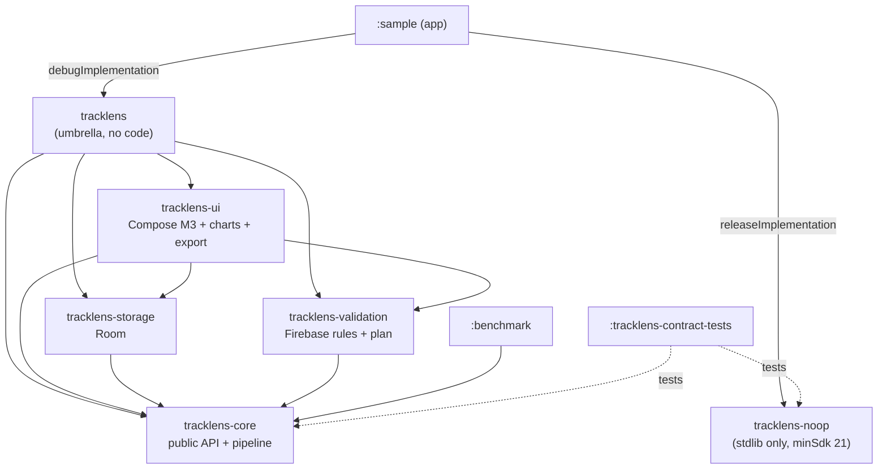
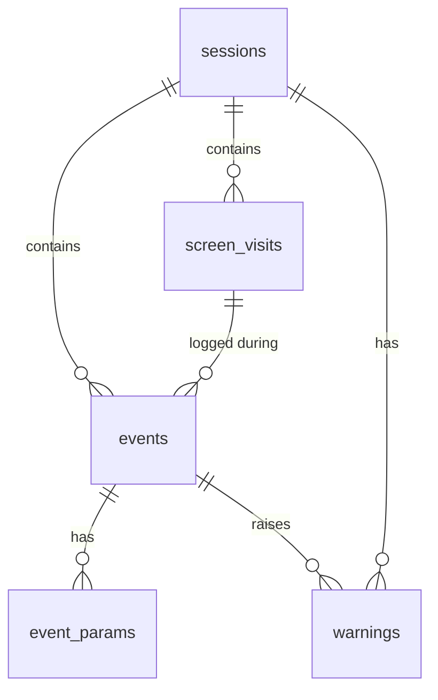
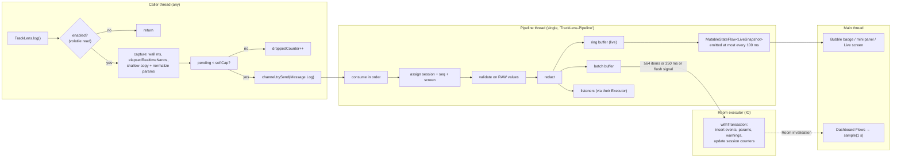
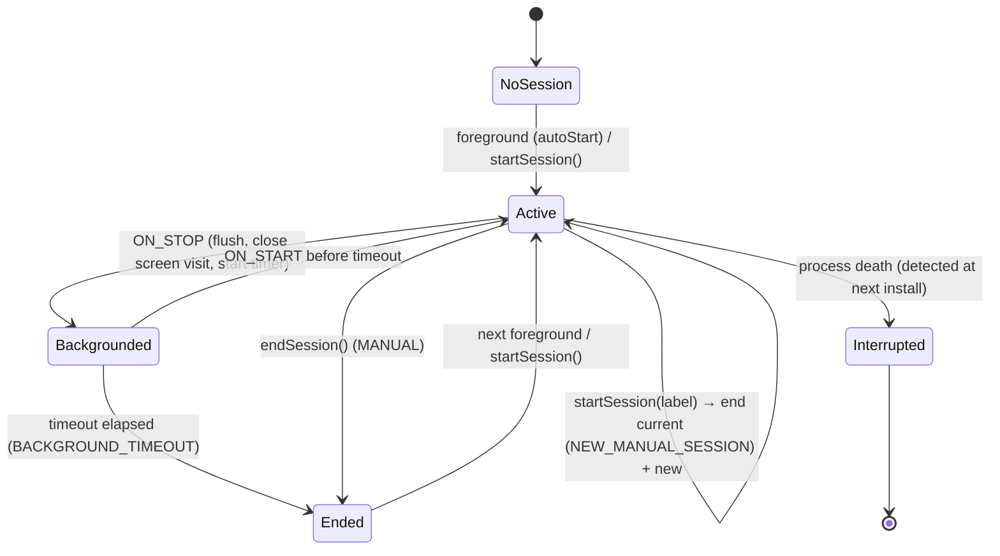
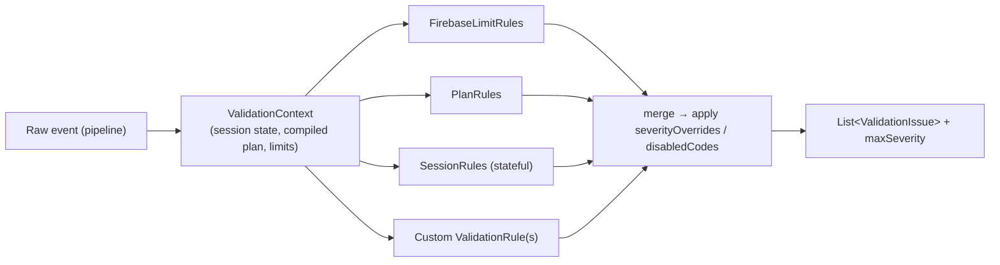

# TrackLens: Implementation Plan

> Debug/QA analytics companion for Android: a live on-device event viewer, persistent test sessions, a visual session dashboard, tracking-plan validation and exportable evidence. Release builds use a no-op artifact.

**Status:** Plan v1 (pre-implementation) · **Date:** 2026-11-25 · **Repository:** this `TrackSpec` Gradle project (the existing `:app` module becomes `:sample`)

---

## 0. Assumptions and decisions taken instead of clarifying questions

None of the open points blocked the plan, so I used these defaults. Each one can be changed cheaply now and gets expensive after Phase 1.

| # | Topic | Decision | Why |
|---|---|---|---|
| A1 | Maven coordinates | `io.github.tracklens:<artifact>` (placeholder; must match a Central Portal–verified namespace) | `io.github.<owner>` can be verified without owning a domain. |
| A2 | Root package | `io.github.tracklens` (public API), `io.github.tracklens.internal.*` (everything else) | Lets R8 rules, BCV filters and `apiDump` target internals in one place. |
| A3 | License | Apache-2.0 | Same as Chucker and most of AndroidX; works for corporate users. |
| A4 | Toolchain | Use what the scaffold already pins: **AGP 9.5.2, Kotlin 2.4.21, Gradle 9.9.2, compileSdk 37 / targetSdk 37.** Runtime libraries follow the "stable minus one minor" rule in `docs/dependencies.md` (Compose BOM 2026.09.00 = Compose 1.12.1 / Material3 1.4.0, Room 2.7.2); tooling and tests use latest stable. | Pinned in Task 4. Keeps TrackLens from dragging host debug builds onto the newest AndroidX lines and their higher SDK floors. |
| A5 | minSdk | **23 for all debug modules, 21 for `tracklens-noop`** (see §0.1) | — |
| A6 | Bytecode target | JVM 11 | Widest host compatibility. AGP 9 needs JDK 17+ to *run*, not to target. |
| A7 | DI | No DI framework. One internal service locator (`TrackLensGraph`). | Hilt or Koin would clash with host setups. |
| A8 | In-library navigation | A small custom back stack, not Navigation-Compose | Avoids forcing a Navigation version onto the host's debug classpath. |
| A9 | JSON | `kotlinx-serialization-json` internally. YAML plans via `kaml`, which can be excluded. | Typed models and one codec shared by plan, export and DB `params_json`. |
| A10 | Paging | Manual keyset pagination, no Paging 3 | Retention keeps the data small, and it is one fewer dependency. |

### 0.1 minSdk justification (deviation from the "21" default)

- **minSdk follows the runtime dependencies' floor.** With the stable-minus-one policy (Compose 1.12 / Material3 1.4) that floor is 23. Material3 1.5 raises it to 24, so debug minSdk will move to 24 when Material3 1.5 becomes the policy line (Task 1 briefly used 24 for this reason).

- Recent AndroidX releases (Compose, Activity, Lifecycle, Room) have moved to minSdk 23, and the newest lines to 24. Pinning old versions to keep 21 would freeze the UI stack.
- API 21–22 devices make up well under 1% of active devices and are essentially absent from QA device labs. TrackLens only ever runs on debug builds.
- API 23+ gives runtime `Settings.canDrawOverlays()` for the optional overlay mode, and `Application.getProcessName()`-style process checks are simpler there (with a fallback before API 28).
- **Release safety matters more than debug reach.** `tracklens-noop` stays at **minSdk 21** with zero AndroidX dependencies, so it never raises a host's release minSdk. A host whose minSdk is 21–22 adds `tools:overrideLibrary` in `src/debug/AndroidManifest.xml`. On those devices TrackLens detects API < 23 at `install()` and behaves as a no-op (a documented limitation).

---

## 1. Architecture overview

### 1.1 Module responsibilities

| Module (artifact) | Type | Depends on | Responsibilities | Ships in release? |
|---|---|---|---|---|
| `tracklens` | Umbrella AAR, no code | core, storage, validation, ui (`api`) | The one coordinate users add with `debugImplementation`. | No |
| `tracklens-core` | Android library | kotlin-stdlib, coroutines, lifecycle-process | **The whole public API** (`TrackLens` facade, config DSL, model types). Event pipeline, ring buffer, session manager, screen breadcrumbs, redaction, kill switch, diagnostics, internal SPI (`@InternalTrackLensApi`), module discovery. | No |
| `tracklens-storage` | Android library | core, Room (KSP), serialization | Room DB, DAOs, batched writer, retention, migrations, repositories used by the UI and by export. | No |
| `tracklens-validation` | Android library | core, serialization, kaml (optional) | Firebase limit rules, tracking-plan parser and compiler, plan rules, session rules, coverage calculator, funnel evaluator. | No |
| `tracklens-ui` | Android library | core, storage, validation, Compose M3, activity-compose | Bubble, mini panel, `TrackLensActivity`, all screens, Canvas charts, dashboard model builder, comparison diff, exporters (JSON/CSV/HTML), FileProvider, app shortcut. | No |
| `tracklens-noop` | Android library | **kotlin-stdlib only** | Byte-for-byte identical public API. Methods do nothing, except `wrap()` (returns the delegate) and the Bundle/Map helpers (real implementations). | **Yes** |
| `:sample` | App | `debugImplementation(tracklens)`, `releaseImplementation(tracklens-noop)` | Fake analytics SDKs, demo flows, a demo tracking plan, manual QA script. | — |
| `:benchmark` | androidx.benchmark | core | Microbenchmark for `log()` overhead. | — |
| `:tracklens-contract-tests` | Test fixtures (not published) | — | One API contract test suite run against core **and** noop. | — |
| `build-logic` | Included build | — | Convention plugins. | — |

**Deviation from the requested module list:** I added the umbrella artifact, so users declare one dependency and the UI, storage and validation modules stay separately swappable. Dashboard/report computation lives in `tracklens-ui` under a `report` package. It is pure Kotlin and can move into its own `tracklens-report` module later without API impact.

### 1.2 Module dependency diagram



### 1.3 How the modules find each other at runtime

`core` cannot depend on `ui`, `storage` or `validation`, so it discovers them at `install()` with `ServiceLoader.load(TrackLensModule::class.java)`. Each module ships `META-INF/services/io.github.tracklens.internal.spi.TrackLensModule`. The consumer R8 rules keep those implementations in case a host minifies its debug build. If a module is missing, its feature degrades quietly: no storage means live-only mode, no UI means headless mode for instrumentation tests.

```mermaid
flowchart LR
    install["TrackLens.install()"] --> graph["TrackLensGraph"]
    graph -->|ServiceLoader| m1["StorageModule → EventStore"]
    graph -->|ServiceLoader| m2["ValidationModule → EventValidator"]
    graph -->|ServiceLoader| m3["UiModule → OverlayHost, PanelLauncher, Exporter"]
```

---

## 2. Public API design

### 2.1 Design rules

- **Explicit API mode** in every published module. Public API lives only in `tracklens-core` under `io.github.tracklens`.
- **No coroutine, Flow, Room or Compose types in public signatures.** If any of them leaked in, the noop artifact would need those dependencies. State is exposed through listener interfaces. `StateFlow` is used internally and by the UI module through `@InternalTrackLensApi` types.
- **No `data class`, `value class`, `kotlin.time.Duration` or `Result` in public API.** They are binary-compatibility hazards or awkward from Java. Use plain classes with builders, `Long` millis plus `TimeUnit` overloads, and callback interfaces.
- Every public entry point is wrapped in `guard { }` and never throws (§4.7).
- Cross-module internals are `public` but annotated with `@InternalTrackLensApi` (a `RequiresOptIn` at level ERROR). The ABI dump excludes them through BCV's `nonPublicMarkers` (Task 6).

### 2.2 Setup and lifecycle

```kotlin
package io.github.tracklens

public object TrackLens {
    /** Must be called from Application.onCreate(). Idempotent. No-op on API < 23 and in non-main processes (configurable). */
    @JvmStatic @JvmOverloads
    public fun install(application: Application, config: TrackLensConfig = TrackLensConfig.DEFAULT)

    @JvmStatic public val isInstalled: Boolean
    /** true in tracklens-noop. Lets host code skip debug-only work. */
    @JvmStatic public val isNoOp: Boolean
    /** Runtime kill switch. When false, log() returns after one volatile read. */
    @JvmStatic public var isEnabled: Boolean
    @JvmStatic public val libraryVersion: String
}
```

### 2.3 Logging

```kotlin
public object TrackLens {
    @JvmStatic public fun log(name: String)
    @JvmStatic @JvmOverloads public fun log(name: String, params: Map<String, Any?>, source: String? = null)
    @JvmStatic @JvmOverloads public fun log(name: String, params: Bundle, source: String? = null)

    @JvmStatic @JvmOverloads public fun setUserProperty(name: String, value: String?, source: String? = null)
    /** Stored redacted according to RedactionConfig.userId (default: HASH). */
    @JvmStatic @JvmOverloads public fun setUserId(userId: String?, source: String? = null)

    /** Manual screen breadcrumb (Compose screens, custom view systems). Overrides automatic breadcrumbs until the next Activity change. */
    @JvmStatic @JvmOverloads public fun setScreen(name: String, screenClass: String? = null)
}
```

**Overload notes:** `params: Bundle` is non-null and `Map` is the only nullable-friendly overload, so `log("x", null)` is never ambiguous in Kotlin. `source` tags the SDK ("firebase", "amplitude") for filtering when several SDKs are wrapped.

### 2.4 Wrapping (SDK-agnostic forwarding)

```kotlin
/** Implement once per analytics SDK. A fun interface, so the Kotlin and Java lambda forms work. */
public fun interface AnalyticsDelegate {
    public fun logEvent(name: String, params: Map<String, Any?>)
    public fun setUserProperty(name: String, value: String?) {}
    public fun setUserId(userId: String?) {}

    public companion object { public const val DEFAULT_SOURCE: String = "default" }
}

public object TrackLens {
    /**
     * Returns a delegate that records into TrackLens and then forwards the ORIGINAL, unredacted
     * params to [delegate]. Exceptions thrown by [delegate] propagate unchanged, so host behavior
     * is the same in debug and release. The noop returns [delegate] itself.
     */
    @JvmStatic @JvmOverloads
    // `delegate` last so a trailing lambda works: TrackLens.wrap(source = "firebase") { name, params -> ... } (fixed in Task 8)
    public fun wrap(source: String = AnalyticsDelegate.DEFAULT_SOURCE, delegate: AnalyticsDelegate): AnalyticsDelegate
}

/** Pure conversion helpers. Implemented for real in BOTH core and noop, because release forwarding relies on them. */
public object TrackLensBundles {
    @JvmStatic public fun toBundle(params: Map<String, Any?>): Bundle
    @JvmStatic public fun toMap(bundle: Bundle): Map<String, Any?>
}
public fun Map<String, Any?>.toBundle(): Bundle      // @file:JvmName("TrackLensBundleKt")
```

### 2.5 Sessions

```kotlin
public object TrackLens {
    /** Ends the current session (reason MANUAL) and starts a new manual session that is never auto-ended by the background timeout. */
    @JvmStatic @JvmOverloads public fun startSession(label: String? = null)
    @JvmStatic public fun endSession()
    @JvmStatic public fun setSessionLabel(label: String?)
    @JvmStatic public fun setSessionNotes(notes: String?)
    /** UUID string of the active session, or null. */
    @JvmStatic public val currentSessionId: String?
}
```

### 2.6 UI, data and observation

```kotlin
public object TrackLens {
    @JvmStatic public fun openPanel(context: Context)
    @JvmStatic public fun showBubble()
    @JvmStatic public fun hideBubble()

    /** Deletes all sessions, events, exports and preferences. Asynchronous; callback on the main thread. */
    @JvmStatic @JvmOverloads public fun clearAllData(callback: CompletionCallback? = null)

    @JvmStatic public fun exportSession(context: Context, sessionId: String, format: ExportFormat, callback: ExportCallback)

    /** Callbacks run on [executor] (default: main thread). Returns a handle used to unsubscribe. */
    @JvmStatic @JvmOverloads
    public fun addListener(listener: TrackLensListener, executor: Executor? = null): Subscription
}

public fun interface TrackLensListener { public fun onEvent(event: TrackedEvent) }
public fun interface Subscription { public fun cancel() }
public fun interface CompletionCallback { public fun onComplete(success: Boolean) }
public interface ExportCallback {
    public fun onExported(uri: Uri, mimeType: String)
    public fun onFailed(reason: String)
}
public enum class ExportFormat { JSON, CSV, HTML }
```

### 2.7 Model types (public, read-only)

```kotlin
public enum class EventKind { EVENT, USER_PROPERTY, USER_ID, SCREEN }
public enum class Severity { INFO, WARNING, ERROR }

public class TrackedEvent internal constructor(/* ... */) {
    public val sequence: Long                 // per-session, starting at 1
    public val timestampMillis: Long          // wall clock (display/export)
    public val elapsedMillis: Long            // since session start (monotonic, used by charts)
    public val name: String
    public val kind: EventKind
    public val params: Map<String, Any?>      // normalized and REDACTED
    public val screen: String?
    public val sessionId: String
    public val source: String?
    public val issues: List<ValidationIssue>
}

public class ValidationIssue internal constructor(/* ... */) {
    public val code: String                   // stable, e.g. "FB_EVENT_NAME_TOO_LONG"
    public val severity: Severity
    public val message: String
    public val paramKey: String?
}

/** Custom rule, registered through ValidationConfig. Runs on the pipeline thread and must be fast and pure. */
public fun interface ValidationRule {
    public fun validate(event: TrackedEvent): List<ValidationIssue>
}
public object ValidationIssues {
    @JvmStatic @JvmOverloads
    public fun create(code: String, severity: Severity, message: String, paramKey: String? = null): ValidationIssue
}
```

### 2.8 Configuration (builder plus Kotlin DSL)

> **As built (Task 8):** builders expose **fluent methods only** (`backgroundTimeout(30, SECONDS)`, `trackingPlanAsset("…")`), not `var` properties, so Kotlin and Java share one API. Out-of-range values are clamped, never thrown. Severity overrides are `severity(code, severity)`. The signatures below show the shape; `tracklens-core/api/tracklens-core.api` is authoritative.

```kotlin
@DslMarker public annotation class TrackLensDsl

public class TrackLensConfig private constructor(/* builder */) {
    public val enabled: Boolean                       // default true
    public val mainProcessOnly: Boolean               // default true
    public val liveBufferSize: Int                    // default 2_000 (ring buffer)
    public val sessions: SessionConfig
    public val bubble: BubbleConfig
    public val retention: RetentionConfig
    public val redaction: RedactionConfig
    public val validation: ValidationConfig
    public val breadcrumbs: BreadcrumbConfig
    public val categorizer: EventCategorizer
    public val theme: ThemeConfig
    public fun newBuilder(): Builder

    @TrackLensDsl public class Builder {
        public var enabled: Boolean
        public var mainProcessOnly: Boolean
        public var liveBufferSize: Int
        public fun sessions(block: SessionConfig.Builder.() -> Unit): Builder
        public fun sessions(config: SessionConfig): Builder            // Java
        public fun bubble(block: BubbleConfig.Builder.() -> Unit): Builder
        public fun bubble(config: BubbleConfig): Builder
        public fun retention(block: RetentionConfig.Builder.() -> Unit): Builder
        public fun retention(config: RetentionConfig): Builder
        public fun redaction(block: RedactionConfig.Builder.() -> Unit): Builder
        public fun redaction(config: RedactionConfig): Builder
        public fun validation(block: ValidationConfig.Builder.() -> Unit): Builder
        public fun validation(config: ValidationConfig): Builder
        public fun breadcrumbs(block: BreadcrumbConfig.Builder.() -> Unit): Builder
        public fun breadcrumbs(config: BreadcrumbConfig): Builder
        public fun categorizer(categorizer: EventCategorizer): Builder
        public fun theme(block: ThemeConfig.Builder.() -> Unit): Builder
        public fun build(): TrackLensConfig
    }
    public companion object { @JvmField public val DEFAULT: TrackLensConfig }
}

public inline fun trackLensConfig(block: TrackLensConfig.Builder.() -> Unit): TrackLensConfig  // @file:JvmName("TrackLensConfigs")

public class SessionConfig /* Builder */ {
    public val autoStart: Boolean                    // default true
    public val backgroundTimeoutMillis: Long         // default 30_000
    public val manualSessionsSurviveBackground: Boolean // default true
    // Builder: backgroundTimeout(value: Long, unit: TimeUnit)
}
public enum class OverlayMode { IN_APP, SYSTEM_OVERLAY_IF_PERMITTED, NONE }
public enum class Edge { START, END }
public class BubbleConfig /* Builder */ {
    public val overlayMode: OverlayMode              // default IN_APP
    public val initialEdge: Edge                     // default END
    public val showAppShortcut: Boolean              // default true (dynamic launcher shortcut)
    public val excludedActivities: Set<String>       // FQCNs
}
public class RetentionConfig /* Builder */ {
    public val maxSessions: Int                      // default 50 (pinned sessions exempt)
    public val maxAgeMillis: Long                    // default 7 days
    public val maxEventsPerSession: Int              // default 10_000
}
public enum class UserIdRedaction { NONE, HASH, MASK }
public class RedactionPattern private constructor(public val id: String, public val regex: String) {
    public companion object {
        @JvmField public val EMAIL: RedactionPattern
        @JvmField public val PHONE: RedactionPattern
        @JvmField public val CREDIT_CARD: RedactionPattern   // regex + Luhn check
        @JvmField public val IPV4: RedactionPattern
        @JvmStatic public fun custom(id: String, regex: String): RedactionPattern
    }
}
public class RedactionConfig /* Builder */ {
    public val keys: Set<String>                     // case-insensitive, glob: "*_token", "email"
    public val patterns: List<RedactionPattern>
    public val replacement: String                   // default "[REDACTED]"
    public val hashValues: Boolean                   // true → "sha256:3f9a1c2e" (equal values stay comparable)
    public val userId: UserIdRedaction               // default HASH
}
public class ValidationConfig /* Builder */ {
    public val firebaseLimits: Boolean               // default true
    public val trackingPlanAsset: String?            // e.g. "tracklens/tracking_plan.yaml"
    public val trackingPlanProvider: TrackingPlanProvider?
    public val rules: List<ValidationRule>
    public val severityOverrides: Map<String, Severity>
    public val disabledCodes: Set<String>
    // Builder: rule(r), severity(code, severity), disable(code)
}
public fun interface TrackingPlanProvider { public fun open(): InputStream? }
public class BreadcrumbConfig /* Builder */ {
    public val activities: Boolean                   // default true
    public val fragments: Boolean                    // default true (no-op if androidx.fragment is absent)
    public val screenViewEventAsScreen: Boolean      // default true: "screen_view" + screen_name param → screen change
    public val screenNameResolver: ScreenNameResolver
}
public fun interface ScreenNameResolver { public fun resolve(component: Any): String? }   // Activity or Fragment; null = skip
public fun interface EventCategorizer { public fun categoryOf(eventName: String): String? }
public class ThemeConfig /* Builder */ {
    public val darkMode: DarkMode                    // SYSTEM | LIGHT | DARK
    public val seedColorArgb: Int?                   // null = TrackLens default palette
    public val dynamicColor: Boolean                 // default false (keeps screenshots stable)
}
```

### 2.9 Usage example (Kotlin)

```kotlin
TrackLens.install(this, trackLensConfig {
    sessions { backgroundTimeout(30, TimeUnit.SECONDS) }
    redaction { keys("email", "phone", "*_token"); patterns(RedactionPattern.EMAIL, RedactionPattern.PHONE) }
    validation { trackingPlanAsset("tracklens/tracking_plan.yaml"); severity("FB_PARAM_VALUE_TOO_LONG", Severity.ERROR) }
})
val analytics: AnalyticsDelegate = TrackLens.wrap(source = "firebase") { name, params -> firebase.logEvent(name, params.toBundle()) }
```

### 2.10 Java interop notes

| Concern | Approach |
|---|---|
| Static access | `@JvmStatic` on every facade member, so Java calls `TrackLens.log("x")`. Properties become `TrackLens.isEnabled()` and `TrackLens.setEnabled(false)`. |
| Default arguments | `@JvmOverloads` everywhere defaults exist. |
| DSL | Every lambda-taking builder method has a `Builder`-object overload. `new TrackLensConfig.Builder().sessions(new SessionConfig.Builder().backgroundTimeout(30, TimeUnit.SECONDS).build()).build()` |
| SAM | `fun interface` means Java lambdas work. Kotlin interface default methods compile to Java `default` methods (Kotlin 2.2+ `-jvm-default=enable`), so Java implements only `logEvent`. |
| Durations | `Long` millis plus `(Long, TimeUnit)` overloads. No `kotlin.time.Duration`, whose inline class mangles names. |
| Async | Callback interfaces (`ExportCallback`, `CompletionCallback`). No `suspend`, `Flow` or `Result`. |
| Nullability | Kotlin emits `@Nullable`/`@NotNull`. Checked in a Java compile test inside `:tracklens-contract-tests`. |
| Top-level functions | `@file:JvmName` gives stable class names (`TrackLensConfigs`, `TrackLensBundleKt`). |

---

## 3. Data model and Room schema

### 3.1 Storage location and privacy

- DB file: `File(context.noBackupFilesDir, "tracklens.db")`. It is never part of Auto Backup or device transfer, whatever the host's backup rules say.
- Exports: `cacheDir/tracklens-exports/`, deleted 24 h after creation and on `clearAllData()`.
- The library manifest declares **no `<uses-permission>`**. CI asserts this (§9).

### 3.2 Entities

**`sessions`**

| Column | Type | Notes |
|---|---|---|
| `id` | INTEGER PK autoinc | Internal key |
| `uuid` | TEXT UNIQUE | Public session id (API and export) |
| `label`, `notes` | TEXT? | Tester-provided |
| `started_at`, `ended_at` | INTEGER (epoch ms) | `ended_at` null = active |
| `start_elapsed_realtime` | INTEGER | Monotonic anchor |
| `end_reason` | TEXT | `ACTIVE`, `BACKGROUND_TIMEOUT`, `MANUAL`, `NEW_MANUAL_SESSION`, `INTERRUPTED` |
| `is_manual`, `pinned`, `truncated` | INTEGER (bool) | `pinned` = exempt from retention; `truncated` = maxEventsPerSession hit |
| `app_version_name`, `app_version_code`, `build_type`, `app_id` | TEXT/INTEGER | `build_type` from `ApplicationInfo.FLAG_DEBUGGABLE` plus optional `BuildConfig` override |
| `device_manufacturer`, `device_model`, `os_release`, `os_sdk_int`, `locale`, `screen_density` | TEXT/INTEGER | |
| `plan_name`, `plan_version`, `plan_hash` | TEXT? | The plan used when validating |
| `event_count`, `warning_count`, `error_count`, `dropped_count` | INTEGER | Denormalized; updated in the writer transaction |
| `library_version` | TEXT | |

Indices: `uuid` (unique), `started_at`.

**`events`**

| Column | Type | Notes |
|---|---|---|
| `id` | INTEGER PK | |
| `session_id` | INTEGER FK → sessions ON DELETE CASCADE | |
| `seq` | INTEGER | Per session, starting at 1 |
| `timestamp` | INTEGER | Wall clock |
| `elapsed_ms` | INTEGER | Since session start, monotonic |
| `kind` | TEXT | `EVENT`, `USER_PROPERTY`, `USER_ID`, `SCREEN` |
| `name` | TEXT | Event name, property name, or screen |
| `source` | TEXT? | SDK tag |
| `category` | TEXT? | From plan, then categorizer, then null |
| `screen_name` | TEXT? | Screen at log time |
| `screen_visit_id` | INTEGER? FK → screen_visits SET NULL | |
| `params_json` | TEXT | Redacted, typed JSON, used for detail view and export |
| `param_count` | INTEGER | |
| `max_severity` | INTEGER | 0 none, 1 info, 2 warning, 3 error (drives chart colors without a join) |

Indices: `(session_id, seq)` UNIQUE, `(session_id, name)`, `(session_id, elapsed_ms)`, `(session_id, max_severity)`.

**`event_params`** (queryable copy; `params_json` keeps rendering fast)

| Column | Type | Notes |
|---|---|---|
| `id` | INTEGER PK | |
| `event_id` | INTEGER FK → events CASCADE | |
| `session_id` | INTEGER | Denormalized for per-session param queries |
| `key` | TEXT | Top-level keys only; nested values stay in JSON |
| `value_type` | TEXT | `STRING`, `LONG`, `DOUBLE`, `BOOLEAN`, `NULL`, `ARRAY`, `BUNDLE`, `OTHER` |
| `value_text` | TEXT? | Redacted string form |
| `value_num` | REAL? | Numeric form, for range queries |
| `redacted` | INTEGER (bool) | |

Indices: `event_id`, `(session_id, key)`, `(session_id, key, value_text)`. Used for search by `key=value`, param-coverage reports, and future funnel `where` filters in SQL.

**`screen_visits`**

| Column | Type | Notes |
|---|---|---|
| `id` | INTEGER PK | |
| `session_id` | INTEGER FK CASCADE | |
| `order_index` | INTEGER | 0..n |
| `screen_name`, `screen_class` | TEXT | |
| `source` | TEXT | `ACTIVITY`, `FRAGMENT`, `COMPOSE`, `MANUAL`, `SCREEN_VIEW_EVENT` |
| `entered_elapsed_ms`, `exited_elapsed_ms` | INTEGER / INTEGER? | Foreground time only; backgrounding closes the visit |
| `duration_ms` | INTEGER? | Set on exit |

Index: `(session_id, order_index)` UNIQUE.

**`warnings`**

| Column | Type | Notes |
|---|---|---|
| `id` | INTEGER PK | |
| `session_id` | INTEGER FK CASCADE | |
| `event_id` | INTEGER? FK CASCADE | null = session-level warning (truncation, dropped events) |
| `code` | TEXT | Stable rule code |
| `severity` | INTEGER | 1–3 |
| `message` | TEXT | |
| `param_key` | TEXT? | |

Indices: `(session_id, code)`, `event_id`.

**`diagnostics`** (internal failures, capped at 500 rows by trigger-free trimming in the writer)

| `id` | `timestamp` | `component` | `level` | `message` | `stacktrace` |
|---|---|---|---|---|---|

### 3.3 Relations



### 3.4 Key DAO queries by dashboard widget

All dashboard queries return lightweight `@Projection`-style POJOs, never full entities.

| Widget | Query (abridged) | Post-processing in Kotlin |
|---|---|---|
| Session list | `SELECT id, uuid, label, started_at, ended_at, end_reason, event_count, warning_count, error_count, pinned, is_manual FROM sessions ORDER BY ended_at IS NOT NULL, started_at DESC` | Active session first |
| Summary card | `SELECT COUNT(*) AS total, COUNT(DISTINCT name) AS uniq, SUM(max_severity = 3) AS invalid FROM events WHERE session_id = :id AND kind = 'EVENT'`, plus `SELECT COUNT(DISTINCT screen_name) FROM screen_visits WHERE session_id = :id` and `SELECT COUNT(*) FROM warnings WHERE session_id = :id` | Pass rate = `(total − invalid) / total`. Duration from session row (or `now` if active). |
| Timeline | `SELECT id, seq, elapsed_ms, name, category, max_severity FROM events WHERE session_id = :id ORDER BY seq` | Sorted array of x positions for binary-search hit-testing and viewport culling |
| Events per minute | `SELECT elapsed_ms / :bucketMs AS bucket, COUNT(*) AS c, SUM(max_severity >= 2) AS warn FROM events WHERE session_id = :id AND kind = 'EVENT' GROUP BY bucket ORDER BY bucket` | Fill empty buckets with zero. `bucketMs` is adaptive (§5.4). |
| Top events | `SELECT name, COUNT(*) AS c, MAX(max_severity) AS sev FROM events WHERE session_id = :id AND kind = 'EVENT' GROUP BY name ORDER BY c DESC LIMIT :n` | — |
| Rarely or never fired | Same grouped counts without `LIMIT` | Diff against `CompiledPlan.activeEvents`. Never = planned but absent; rare = count ≤ `rareThreshold` (default 1). |
| Screen flow | `SELECT id, order_index, screen_name, source, entered_elapsed_ms, duration_ms FROM screen_visits WHERE session_id = :id ORDER BY order_index`, plus `SELECT screen_visit_id, COUNT(*) FROM events WHERE session_id = :id GROUP BY screen_visit_id` | Collapse consecutive duplicates. Compute transitions. |
| Warnings grouped | `SELECT code, severity, COUNT(*) FROM warnings WHERE session_id = :id GROUP BY code ORDER BY severity DESC, COUNT(*) DESC`, then per group `SELECT w.*, e.seq, e.name FROM warnings w LEFT JOIN events e ON e.id = w.event_id WHERE w.session_id = :id AND w.code = :code ORDER BY e.seq LIMIT 200` | — |
| Coverage | Grouped counts, plus `SELECT name, COUNT(*) FROM events WHERE session_id = :id AND max_severity = 3 GROUP BY name` | Join with plan → seen, invalid, unknown, deprecated |
| Funnels | `SELECT seq, elapsed_ms, name, params_json FROM events WHERE session_id = :id AND kind = 'EVENT' AND name IN (:funnelEventNames) ORDER BY seq` | Funnel evaluator (§6.5) |
| Comparison: counts | `SELECT session_id, name, COUNT(*) FROM events WHERE session_id IN (:a, :b) AND kind = 'EVENT' GROUP BY session_id, name` | Missing, extra, count deltas |
| Comparison: order | `SELECT name FROM events WHERE session_id = :id AND kind = 'EVENT' ORDER BY seq LIMIT 5000` | Myers diff of name sequences |
| Event list (history) | `SELECT … FROM events WHERE session_id = :id AND seq > :afterSeq [AND name LIKE :q] [AND max_severity >= :minSev] ORDER BY seq LIMIT 200` | Keyset paging |
| Search by param | `SELECT DISTINCT event_id FROM event_params WHERE session_id = :id AND key = :k AND value_text LIKE :v` | — |

Active-session dashboards observe Room `Flow`s that re-emit on each batch write (about every 250 ms). The ViewModel applies `conflate()` plus `sample(1_000)` so charts update at most once a second.

### 3.5 Retention policy

Runs on `install()` (delayed 5 s), on every session end, and after `clearAllData()`.

1. `DELETE FROM sessions WHERE pinned = 0 AND ended_at IS NOT NULL AND started_at < :now - :maxAge`
2. `DELETE FROM sessions WHERE pinned = 0 AND ended_at IS NOT NULL AND id NOT IN (SELECT id FROM sessions ORDER BY started_at DESC LIMIT :maxSessions)`
3. `maxEventsPerSession` is enforced in the writer, not by deletion. When a session reaches the cap, the writer stops persisting new events for it, sets `truncated = 1` and inserts a session-level `SE_SESSION_TRUNCATED` warning. The live view keeps working. This keeps the evidence of the start of a flow, which matters more for reproduction than the tail.
4. When more than 20% of pages are free, `PRAGMA incremental_vacuum` (the DB is created with `auto_vacuum = INCREMENTAL` in `onCreate`).

### 3.6 Migrations strategy

- `exportSchema = true` through the Room Gradle plugin, with schemas committed under `tracklens-storage/schemas/`.
- **Before 1.0:** `fallbackToDestructiveMigration(dropAllTables = true)` is allowed. The data is debug-only and disposable. The changelog notes when a schema change will wipe it.
- **From 1.0:** every schema bump ships an `@AutoMigration` (or a manual `Migration` plus a spec) and a `MigrationTestHelper` test for every historical version up to the current one. Destructive fallback remains only `OnDowngrade`.
- CI fails if `schemas/` contains a version with no corresponding migration test (a small Gradle check task).

---

## 4. Threading and lifecycle design

### 4.1 Event flow



**Key properties**

- **One ordered queue for everything.** Log calls, screen changes, foreground and background signals, and session commands are all `Message` subclasses on the same `Channel(UNLIMITED)`. The single consumer therefore sees a total order. "Which screen was this event on?" and "which session does it belong to?" are answered without locks or races.
- **Soft cap:** an `AtomicInteger pending` (default cap 10,000) applies to `Log` messages only. Control messages always get through. Dropped events increment a counter that is shown in the UI and stored as a session warning.
- **Validation runs on raw values, then redaction runs.** That way length checks still work on redacted values, and nothing unredacted is retained in memory or on disk.
- `wrap()` forwards the **original** map to the host's delegate on the caller thread after the enqueue. TrackLens never mutates host data.

### 4.2 Caller-thread cost budget (target < 0.1 ms; design goal < 10 µs at p50)

| Step | Expected cost | Notes |
|---|---|---|
| Kill-switch check | < 10 ns | `@Volatile` boolean |
| Timestamps | about 50 ns | `System.currentTimeMillis()` and `SystemClock.elapsedRealtimeNanos()` |
| Param shallow copy and normalization | 1–5 µs (10 params) | `Bundle` keys copied into a `LinkedHashMap`. Nested Bundles and arrays converted up to depth 3. Other objects stored as `toString()` with an `OTHER` type marker, truncated to 1 KB. |
| `trySend` | under 1 µs | Lock-free linked queue |
| **Not done here** | — | Validation, redaction, JSON encoding, DB, UI |

### 4.3 Pipeline thread

- A dedicated single-thread `Executor` turned into a coroutine dispatcher, with a thread named for traces, `Process.THREAD_PRIORITY_BACKGROUND`, and a scope with a `SupervisorJob` plus a `CoroutineExceptionHandler` that reports to diagnostics.
- Ring buffer: a fixed `Array<TrackedEvent?>` of `liveBufferSize` with head/size indices. Snapshots are immutable `List` copies, made only when a 100 ms ticker sees the dirty flag. Copying 2,000 references is trivial.
- `unreadCount` is a `StateFlow<Int>` reset when the Live screen is visible.
- **Pause** in the Live screen freezes the *view*, not the pipeline. The screen stops collecting new snapshots and shows "N new events" until resumed.
- **Clear log** empties the ring buffer only. Stored sessions are deleted separately with explicit confirmation.

### 4.4 Persistence (batched writer)

- Flush triggers: 64 buffered items, 250 ms since the first unflushed item, `ProcessLifecycle ON_STOP`, session end, `onTrimMemory(TRIM_MEMORY_UI_HIDDEN)`, and the uncaught-exception hook.
- **Crash flush:** TrackLens installs a chaining `Thread.UncaughtExceptionHandler`. It does a synchronous flush with an 800 ms budget, then always delegates to the previous handler, so the crash reporter still sees the crash.
- Backpressure: if the DB falls behind and more than 5,000 items are buffered, the oldest are dropped from persistence only, with a diagnostic and a session warning.
- A circuit breaker turns storage off after 5 consecutive write failures. The live view continues, and the Diagnostics screen shows the cause.

### 4.5 Sessions



- Foreground and background come from `ProcessLifecycleOwner` (`lifecycle-process`). Its own 700 ms debounce absorbs configuration changes.
- The timeout timer is a coroutine `delay` on the pipeline. If the process dies while backgrounded, the next `install()` treats any session with `ended_at IS NULL` lazily: `ended_at = last event timestamp`, reason `BACKGROUND_TIMEOUT` if the gap exceeds the timeout, otherwise `INTERRUPTED`.
- Manual sessions (`startSession(label)`) survive background timeouts by default, because a QA run can span app switches such as payment apps or e-mail OTP. They end only on `endSession()`, another `startSession()`, or process death.
- Metadata is captured once at session start: `PackageInfo` (versionName, `longVersionCode`), `FLAG_DEBUGGABLE`, `Build.MANUFACTURER`/`MODEL`, `Build.VERSION.RELEASE`/`SDK_INT`, `Locale.getDefault().toLanguageTag()`, density.
- **Multi-process apps:** `install()` checks the process name (`Application.getProcessName()` on API 28+, `ActivityManager` lookup before that) and no-ops outside the main process when `mainProcessOnly = true`. This is a documented limitation.

### 4.6 Screen breadcrumbs

| Source | Mechanism | Rules |
|---|---|---|
| Activities | `Application.ActivityLifecycleCallbacks.onActivityResumed` | Name from `ScreenNameResolver` (default `simpleName`). `TrackLensActivity` is skipped. |
| Fragments | `FragmentManager.FragmentLifecycleCallbacks(recursive = true)`, registered in `onActivityCreated` when the activity `is FragmentActivity`. Guarded by a `Class.forName("androidx.fragment.app.FragmentActivity")` check, so there is **no** dependency on `androidx.fragment`. | Only resumed fragments that have a view and are visible. `NavHostFragment`, `DialogFragment` and fragments with no view are skipped unless the resolver returns a name. The deepest resumed fragment wins. |
| Compose / manual | `TrackLens.setScreen(name)` | Overrides Activity and Fragment breadcrumbs until the next Activity change |
| `screen_view` events | When `screenViewEventAsScreen` is on, an event named `screen_view` with a `screen_name` param also posts a screen change | Lets Firebase users get breadcrumbs for free |
| Compose Navigation | Documented 3-line snippet: `navController.addOnDestinationChangedListener { _, d, _ -> TrackLens.setScreen(d.route ?: d.label.toString()) }`. An optional `tracklens-navigation` artifact (with a noop twin) is a post-1.0 candidate. | Keeps core and noop free of a `NavController` type |

Each screen change becomes a `Message.Screen` on the pipeline. It closes the previous `screen_visit`, opens a new one, and (configurably) records a `SCREEN` kind row so screens appear inline in the event list.

### 4.7 "Never throw" and diagnostics

- Every public facade method body is `guard("log") { … }`. It catches `Throwable`, including `LinkageError`, because dependency mismatches on host classpaths show up as `NoSuchMethodError`/`NoClassDefFoundError`. It reports the throwable to `Diagnostics` and returns a safe default. A `VirtualMachineError` additionally trips the kill switch.
- Internal coroutine scopes use `CoroutineExceptionHandler`, and listener callbacks are individually guarded.
- Per-component circuit breakers (storage, overlay, validation, export) turn a component off after repeated failures. The rest of TrackLens keeps running.
- Diagnostics are an in-memory ring of 200 entries mirrored to the `diagnostics` table, viewable under More → Diagnostics, with copy and share.
- Exceptions from the host's **own** `AnalyticsDelegate` propagate unchanged. Swallowing them would make debug and release behave differently.

### 4.8 Overlay attachment

**Default: `IN_APP` mode (no permission)**

1. `onActivityResumed(activity)`: if the activity is not excluded and not `TrackLensActivity`, get `activity.window.decorView as? FrameLayout`. If that cast fails, fall back to the parent of `android.R.id.content`. Then add a `BubbleView` (a plain custom `View`, not Compose) as the last child with `elevation = 1000dp`.
2. `onActivityPaused`: detach. Position is stored as `(edge, yFraction)` in TrackLens-private `SharedPreferences`, so the bubble shows up in the same place on every activity and after rotation.
3. Insets: `ViewCompat.setOnApplyWindowInsetsListener` keeps the bubble out of system bars and display cutouts (required for edge-to-edge, which is enforced at targetSdk 35+).
4. Drag: `ViewDragHelper`-style touch handling with touch slop. On release the bubble animates (`SpringAnimation`-like, implemented with a `ValueAnimator` to avoid a dependency) to the nearest edge. Dragging onto a bottom "×" target hides the bubble for the process lifetime.
5. Tap toggles a **mini panel**, a `ComposeView` attached next to the bubble. It shows the last 5 events streaming in, a pause control and an "Open TrackLens" button. The `ComposeView` gets its own `LifecycleOwner` and `SavedStateRegistryOwner` (`setViewTreeLifecycleOwner`) tied to the activity, so it works even in non-`ComponentActivity` hosts.
6. Unread badge: a count drawn on the bubble Canvas ("99+" cap), fed by `unreadCount` on the main thread.

**Optional: `SYSTEM_OVERLAY_IF_PERMITTED`.** Used only if the host declares `SYSTEM_ALERT_WINDOW` in its debug manifest and `Settings.canDrawOverlays()` is true. One bubble lives in a `TYPE_APPLICATION_OVERLAY` window (API 26+), shown only while the app is foregrounded (`ProcessLifecycleOwner`), and stays above dialogs and bottom sheets. Otherwise TrackLens falls back to `IN_APP`. Settings has a button that opens the permission screen. The library itself never declares the permission.

**Other entry points:** a dynamic launcher shortcut, "TrackLens" (`ShortcutManagerCompat`, no permission), and `TrackLens.openPanel(context)`.

---

## 5. UI plan

### 5.1 Screens and in-library navigation

`TrackLensActivity` uses `android:taskAffinity="${applicationId}.tracklens"`, so it shows as a separate task in Recents, like Chucker. It is `exported=false`, uses the platform theme `android:Theme.Material.NoActionBar` (no MDC XML dependency), and calls `enableEdgeToEdge()`. Navigation is a `rememberSaveable` stack of `@Parcelize sealed interface Destination`, with `BackHandler`, which supports predictive back.

| # | Destination | Entry | Main content |
|---|---|---|---|
| 1 | **Live** (tab) | Bubble, shortcut, `openPanel()` | Streaming list, search, filter chips, pause, clear, auto-scroll toggle, dropped-events banner |
| 2 | **Event detail** | Any event row | Header (name, seq, time, screen, source, category), params table with type badges and a redacted marker, validation issues, raw JSON, Copy JSON, Previous/Next, "Show in timeline" |
| 3 | **Sessions** (tab) | Tab | Active session card (label, timer, Start new / End), list of past sessions, multi-select compare, pin, delete, rename |
| 4 | **Session dashboard** | Session row | Scrollable sections: Summary, Timeline, Events per minute, Top events, Planned-not-fired, Screen flow, Warnings, Coverage, Funnels. Top bar: Events list, Compare with…, Export, Edit label/notes. |
| 5 | **Session events** | Dashboard | Same list component as Live, backed by keyset paging |
| 6 | **Compare** | Sessions multi-select, dashboard | Header (A vs B metadata), Counts diff, Missing/Extra, Order diff |
| 7 | **Tracking plan** (tab) | Tab | Plan metadata, events catalog with status, search; coverage across the last N sessions |
| 8 | **Funnel detail** | Dashboard funnel card | Steps with pass/fail and per-step timing |
| 9 | **Settings** (More tab) | Tab | Bubble on/off, overlay mode and permission shortcut, retention values (read-only, from config), theme, Clear all data (confirmation dialog), About |
| 10 | **Diagnostics** (More tab) | Settings | Internal errors, component health, dropped counters, DB size |
| — | Dialogs | — | Start session (label), Edit label/notes, Confirm delete or clear, Export format picker |

### 5.2 Component breakdown

| Package | Components |
|---|---|
| `ui.overlay` | `BubbleView`, `BubblePositionStore`, `OverlayAttacher`, `MiniPanel` (Compose), `SystemOverlayController` |
| `ui.design` | `TrackLensTheme` (M3 color scheme with light and dark, a seed color option, contrast-checked), `CategoryPalette` (Okabe–Ito-based, color-blind safe, eight colors plus hashing), `SeverityBadge`, `KeyValueTable`, `JsonText` (syntax highlighting with `AnnotatedString`), `EmptyState`, `SectionCard` |
| `ui.live` | `LiveViewModel`, `EventList`, `EventRow` (seq, time, name, screen, severity icon, category chip), `FilterBar`, `SearchField` |
| `ui.sessions` | `SessionsViewModel`, `ActiveSessionCard`, `SessionRow`, `SessionEditDialog` |
| `ui.dashboard` | `DashboardViewModel`, `SummaryCard`, `PassRateRing`, `TimelineChart`, `EventsPerMinuteChart`, `TopEventsChart`, `NotFiredList`, `ScreenFlowDiagram`, `WarningsSection`, `CoverageCard`, `FunnelCard` |
| `ui.compare` | `CompareViewModel`, `CountsDiffChart`, `MissingExtraLists`, `OrderDiffList` |
| `ui.charts` | Shared primitives: `ChartAxis`, `NiceTicks` (Heckbert's algorithm), `rememberTextMeasurer` labels, `ChartSemantics`, `HitTester` (binary search), `ZoomState` |
| `report` | `DashboardModelBuilder` (pure), `ComparisonEngine` (Myers diff), `JsonExporter`, `CsvExporter`, `HtmlReportWriter`, `SvgChartRenderer` |

**Rendering-model sharing:** each chart is rendered from an immutable `*ChartModel` (for example `BarSeriesModel` or `TimelineModel`) produced by `DashboardModelBuilder`. The Compose Canvas renderer and the HTML exporter's `SvgChartRenderer` consume the **same model**, so the in-app dashboard and the exported report never disagree.

### 5.3 Search and filters (Live and session events)

- Free text matches event name, param keys and param values (case-insensitive). The live view filters the in-memory snapshot; history uses SQL `LIKE` against `events` and `event_params`.
- Chips: Kind, Source, Category, Screen, Severity ≥ (Info/Warning/Error), "Has issues".
- Filter state lives in the ViewModel with `SavedStateHandle`.

### 5.4 Canvas chart approaches

| Chart | Data | Rendering approach | Interaction | Accessibility |
|---|---|---|---|---|
| **Summary card** | Summary projection | Compose layout (stat tiles). `PassRateRing` uses Canvas `drawArc` (track arc plus value arc, rounded caps). Center label drawn with `drawText(TextMeasurer)`. | Tap a tile to jump to the matching section | Each tile is a merged semantics node ("Warnings: 12") |
| **Event timeline** | `TimelineModel(points: LongArray elapsedMs, lanes: IntArray, severities: ByteArray, durationMs)` | One `Canvas`. Lanes per category (max 6 plus "other"); each event is a 3 dp tick, and an error adds a red triangle marker above it (shape plus color). Time axis with nice ticks and `mm:ss` labels. **Viewport culling:** binary-search the first and last visible index. **Level of detail:** when more than one event falls in a pixel column, draw density bars per column instead of ticks. Screen-visit bands are drawn as alternating subtle background rects with screen names. | `pointerInput { detectTransformGestures }`, horizontal only: zoom from fit-all to 100 ms per 48 dp, pan clamped. Double-tap zooms ×2 around the tap point. Tapping a tick hit-tests within ±12 dp and opens a tooltip card linking to event detail. | Canvas semantics with a summary description, plus a "View as list" button. Zoom buttons (+/−) for users who cannot pinch. |
| **Events per minute** | `BarSeriesModel(buckets, counts, warnCounts)` | Canvas `drawRect` bars with a stacked warning segment in the warning color. Y axis nice ticks, gridlines at 12% alpha. **Adaptive bucket** chosen from {10 s, 30 s, 1 m, 5 m, 15 m} so there are at most 120 bars. Labels say "per minute" only when the bucket is 1 m. | Tap a bar to filter the session event list to that time window | Semantics per bar via an invisible `Row` of focusable nodes sized to the bars ("Minute 3: 42 events, 2 with warnings") |
| **Top events** | Top-N name counts | **Rows, not one big Canvas:** each row is `Text(name)`, a `Canvas` drawing a proportional horizontal bar, and `Text(count)`. The per-row Canvas keeps text in normal composables and works with TalkBack. | Tap a row to open the event list filtered by name | Native row semantics |
| **Rarely or never fired** | Plan diff | `FlowRow` of chips: grey "never" and amber "rare (1)". No chart. | Tap to open the plan entry | — |
| **Screen flow** | Collapsed visits | `LazyColumn` of nodes (rounded rect, screen name, duration, event count). Node **width scales with time spent**, normalized to the longest visit. Connectors are drawn with `Modifier.drawBehind` (vertical line plus arrowhead path) between items. Repeat visits appear as repeated nodes with a "↺ 2nd visit" badge. A toggle switches to **Transitions** view: a table of `from → to × count` with mini bars. | Tap a node to filter events to that visit | Each node: "Cart screen, 1 minute 12 seconds, 8 events" |
| **Warnings** | Grouped counts plus paged rows | `LazyColumn` with `stickyHeader` per code (severity icon, code, count, expandable) | Tap a row to open event detail (scrolled to the issue) | Icons carry `contentDescription`; severity is never shown by color alone |
| **Comparison: counts diff** | Per-name `(countA, countB)` | Rows with a **diverging bar**: a center axis, A extends left, B extends right (Canvas per row). Δ column colored and signed. Sort by abs(Δ), name, or A/B count. | Tap to open a per-event side-by-side occurrence list | Row text includes both counts and the delta |
| **Comparison: order diff** | Myers diff ops (`EQUAL`, `INSERT`, `DELETE`) over name sequences | Unified-diff list: `−` rows (only in A, red tint), `+` rows (only in B, green tint), equal runs collapsed to "… 14 identical events …" | Expand collapsed runs | `+`/`−` glyphs plus text, not only tint |

**Chart guidelines:** all charts read colors from `TrackLensTheme` tokens (light and dark). Text uses `MaterialTheme.typography` with sp sizes, so it respects font scale. Canvases compute their size from constraints and have no fixed pixel sizes. Every chart has an empty state and a "too much data" state.

### 5.5 Theming and customization

- `ThemeConfig` covers dark mode (system, light, dark), an optional seed color, and dynamic color (off by default for stable screenshots).
- `EventCategorizer` plus plan `category` drive the category palette. Unknown categories are hashed into the palette.
- Bubble customization: initial edge, hide on specific activities, enable or disable.

### 5.6 Accessibility checklist (applies to every screen)

- Touch targets ≥ 48 dp, including the bubble (56 dp visual, 48 dp minimum hit area).
- Contrast ≥ 4.5:1 for text and ≥ 3:1 for chart marks against the surface, verified by a unit test over the palette in both themes.
- Color is never the only signal: severity has an icon, and diffs have glyphs.
- TalkBack: the bubble exposes custom actions (Open panel, Hide bubble, Move to other edge) and announces "TrackLens, N unread events".
- Font scale 200% screenshots in CI. Layouts use `FlowRow` and wrapping instead of truncating important data.
- Reduced motion (`ANIMATOR_DURATION_SCALE == 0`) turns off the snapping animation and chart transitions.

---

## 6. Validation engine

### 6.1 Architecture



- Rules are pure functions `(RawEvent, ValidationContext) → List<Issue>`, except `SessionRules`, which reads and writes `SessionValidationState` (distinct names, user properties seen, recent fingerprints, per-name counts). That state resets on session start.
- Budget: < 50 µs per event. The plan is **compiled** once into a `CompiledPlan` (a `HashMap` of name to `EventSpec`, precompiled `Regex`, enum `HashSet`s).
- The plan loads asynchronously at `install()`. Events that arrive before it is ready are validated against Firebase rules immediately and re-checked against the plan once it loads (the pipeline holds a small pre-plan backlog of up to 500 events or 2 s).
- Custom rules see the **redacted** `TrackedEvent` (public type). Built-in rules see raw values. Exceptions in custom rules are caught, reported and the rule turned off.
- Plan load errors (parse error, schema violations) show up as a banner in the Plan tab and in Diagnostics. Validation continues without the plan.

### 6.2 Firebase Analytics limit rules

Limits live in a versioned `FirebaseLimits` object, so they can be updated without code changes elsewhere. **Verify every value against current Firebase/GA4 documentation when implementing Task 38.** The values below are the documented limits as I know them.

| Code | Check | Default | Severity |
|---|---|---|---|
| `FB_EVENT_NAME_EMPTY` | Blank name | — | ERROR |
| `FB_EVENT_NAME_TOO_LONG` | Name length | > 40 chars | ERROR |
| `FB_EVENT_NAME_INVALID` | `^[A-Za-z][A-Za-z0-9_]*$` | — | ERROR |
| `FB_EVENT_NAME_RESERVED` | Reserved names: `ad_activeview`, `ad_click`, `ad_exposure`, `ad_impression`, `ad_query`, `ad_reward`, `adunit_exposure`, `app_background`, `app_clear_data`, `app_exception`, `app_remove`, `app_store_refund`, `app_store_subscription_cancel`, `app_store_subscription_convert`, `app_store_subscription_renew`, `app_update`, `app_upgrade`, `dynamic_link_app_open`, `dynamic_link_app_update`, `dynamic_link_first_open`, `error`, `first_open`, `first_visit`, `in_app_purchase`, `notification_dismiss`, `notification_foreground`, `notification_open`, `notification_receive`, `os_update`, `session_start`, `session_start_with_rollout`, `user_engagement` | — | ERROR |
| `FB_RESERVED_PREFIX` | Event, param or user-property name starts with `firebase_`, `google_` or `ga_` | — | ERROR |
| `FB_TOO_MANY_PARAMS` | Param count | > 25 | ERROR |
| `FB_PARAM_NAME_TOO_LONG` | Param name length | > 40 | ERROR |
| `FB_PARAM_NAME_INVALID` | Same pattern as event names | — | ERROR |
| `FB_PARAM_VALUE_TOO_LONG` | String value length; a per-key override map covers keys such as `page_location`, `page_title` and `page_referrer` | > 100 | WARNING (GA4 truncates) |
| `FB_PARAM_TYPE_UNSUPPORTED` | Value not String, Long/Int, Double/Float, or an `items` Bundle array | — | WARNING |
| `FB_ITEMS_TOO_MANY` | `items` array size | > 200 | WARNING |
| `FB_USER_PROPERTY_NAME_TOO_LONG` | | > 24 | ERROR |
| `FB_USER_PROPERTY_VALUE_TOO_LONG` | | > 36 | ERROR |
| `FB_USER_PROPERTY_RESERVED` | `first_open_time`, `first_visit_time`, `last_deep_link_referrer`, `user_id`, `first_open_after_install`, plus the reserved prefixes | — | ERROR |
| `FB_TOO_MANY_USER_PROPERTIES` | Distinct user-property names in the session | > 25 | WARNING |
| `FB_USER_ID_TOO_LONG` | | > 256 | ERROR |
| `FB_TOO_MANY_EVENT_TYPES` | Distinct event names in the session (heuristic for the 500-type app limit) | > 500 | INFO |
| `FB_NULL_PARAM_VALUE` | Null value (dropped by SDKs) | — | INFO |

Firebase rules apply to all events unless `validation { firebaseLimits = false }`. A per-source toggle (`firebaseLimitSources = setOf("firebase")`) is a Phase 4 stretch goal.

### 6.3 Plan and session rules

| Code | Rule | Default severity |
|---|---|---|
| `PL_UNKNOWN_EVENT` | Name not in plan (and `allowUnknownEvents = false`) | WARNING |
| `PL_DEPRECATED_EVENT` | `status: deprecated` (message includes `replacedBy`) | WARNING |
| `PL_PLANNED_NOT_LIVE` | `status: planned` fired (early implementation) | INFO |
| `PL_MISSING_REQUIRED_PARAM` | Required param missing | ERROR |
| `PL_UNKNOWN_PARAM` | Param not in spec (`allowUnknownParams = false`) | WARNING |
| `PL_PARAM_TYPE_MISMATCH` | `string`, `long`, `double`, `number`, `boolean`, `array`, `object` | ERROR |
| `PL_PARAM_NOT_ALLOWED` | Value not in `allowed` | ERROR |
| `PL_PARAM_PATTERN_MISMATCH` | `pattern` regex fails | ERROR |
| `PL_PARAM_OUT_OF_RANGE` | `min`/`max`, `minLength`/`maxLength` | ERROR |
| `PL_UNEXPECTED_SCREEN` | Event fired outside the listed `screens` | INFO |
| `PL_UNKNOWN_USER_PROPERTY` / `PL_USER_PROPERTY_NOT_ALLOWED` | User-property checks | WARNING / ERROR |
| `SE_DUPLICATE_BURST` | Same name and same param fingerprint within 300 ms (catches double-firing) | WARNING |
| `SE_MAX_PER_SESSION` | Plan `maxPerSession` exceeded (for example `purchase_complete: 1`) | ERROR |
| `SE_SESSION_TRUNCATED` / `SE_EVENTS_DROPPED` | Storage cap or queue soft cap reached | WARNING |

Per-event `severity` overrides in the plan file take precedence over code-level defaults. `ValidationConfig.severityOverrides` takes precedence over both.

### 6.4 Tracking-plan file format

- Location: `src/debug/assets/tracklens/tracking_plan.yaml` (or `.json`). Putting it under the **debug** source set keeps it out of release APKs. Other options: `TrackingPlanProvider` (for example a file pushed with `adb push` into `filesDir`) or `res/raw`.
- The format is detected by extension. YAML is decoded through `kaml` into the same `@Serializable` models. If `kaml` is excluded from the classpath, YAML plans show "YAML support not on classpath" in Diagnostics.
- A JSON Schema (`docs/tracking-plan.schema.json`) is published for IDE autocompletion and for validating plans in CI. A future Gradle task could validate plans at build time.
- `planHash` = SHA-256 of the file bytes, stored per session, so you can see which plan a session was validated against.

```yaml
# src/debug/assets/tracklens/tracking_plan.yaml
schema: tracklens.plan.v1
name: "Shop App"
version: "2026.11.3"
defaults:
  allowUnknownEvents: false
  allowUnknownParams: true
  rareThreshold: 1
categories:
  commerce: { color: "#0072B2" }
  navigation: { color: "#009E73" }
events:
  - name: view_item
    category: commerce
    owner: growth
    description: "Product detail viewed"
    screens: [ProductDetailActivity]
    params:
      item_id:  { type: string, required: true, pattern: "^SKU-[0-9]{4,}$" }
      price:    { type: double, required: true, min: 0 }
      currency: { type: string, required: true, allowed: [USD, EUR, INR] }
  - name: add_to_cart
    category: commerce
    params:
      item_id:  { type: string, required: true }
      quantity: { type: long, required: true, min: 1, max: 99 }
  - name: purchase
    category: commerce
    maxPerSession: 1
    params:
      transaction_id: { type: string, required: true }
      value:          { type: double, required: true, min: 0 }
      items:          { type: array, required: true, maxLength: 200 }
  - name: legacy_checkout_tap
    status: deprecated
    replacedBy: begin_checkout
  - name: wishlist_share
    status: planned
userProperties:
  - name: membership_tier
    type: string
    allowed: [free, gold, platinum]
funnels:
  - id: checkout
    name: "Checkout"
    strict: false            # true: another funnel step out of order = fail
    maxDurationSec: 900
    steps:
      - event: view_item
      - event: add_to_cart
      - event: begin_checkout
      - event: purchase
        where: { currency: USD }
```

Equivalent JSON (excerpt):

```json
{
  "schema": "tracklens.plan.v1",
  "name": "Shop App",
  "version": "2026.11.3",
  "defaults": { "allowUnknownEvents": false, "allowUnknownParams": true },
  "events": [
    { "name": "add_to_cart", "category": "commerce",
      "params": { "item_id": { "type": "string", "required": true },
                  "quantity": { "type": "long", "required": true, "min": 1, "max": 99 } } }
  ],
  "funnels": [ { "id": "checkout", "steps": [ { "event": "view_item" }, { "event": "purchase" } ] } ]
}
```

### 6.5 Coverage report and funnels

**Coverage (per session, and aggregated over the last N sessions or a date range in the Plan tab):**

- `planned` = events with `status: active`, `seen` = planned events with at least one occurrence, `invalid` = planned events with at least one ERROR occurrence, `unknown` = fired names not in the plan, `deprecatedFired` = deprecated events seen.
- Headline: **"X of Y planned events seen, Z invalid"**, plus coverage % = X/Y.
- Per-event row: count, first-seen seq, error count, last error message.

**Funnel evaluator (pure Kotlin, in `tracklens-validation`):**

- Input: an ordered list of `(seq, elapsedMs, name, params)` for the funnel's step names.
- Greedy in-order matching: step *k* matches the first event after step *k−1*'s match whose name equals `step.event` and whose `where` predicates hold (equality on normalized values; `in` lists are allowed).
- `strict = true` fails as soon as a later step's event appears before the current step matches.
- `maxDurationSec` is measured from the first step match to the last.
- Output: `FunnelResult(status = PASSED | PARTIAL(reachedStep) | NOT_STARTED | FAILED(reason), stepMatches[seq, elapsedMs], durations between steps)`.
- The dashboard shows each funnel as a step bar (pass green, stopped step amber, unreached grey). Comparison shows A vs B funnel status side by side.

---

## 7. Export formats

All exports run on IO, are written to `cacheDir/tracklens-exports/<session-uuid>-<timestamp>.<ext>`, and are shared through the library's own `TrackLensFileProvider` (a `FileProvider` subclass, authority `${applicationId}.tracklens.fileprovider`, so it cannot collide with the host's provider) using `ACTION_SEND`, or `ACTION_SEND_MULTIPLE` for CSV pairs, with `FLAG_GRANT_READ_URI_PERMISSION`. Export is the **only** path by which data leaves the device. It is always user-initiated (or `exportSession()` from host code).

### 7.1 JSON (`application/json`), schema `tracklens.session.v1`

```json
{
  "schema": "tracklens.session.v1",
  "exportedAt": "2026-11-25T10:42:13.120Z",
  "libraryVersion": "1.0.0",
  "session": {
    "id": "7c1e1c1a-4b0b-4a36-9d0e-0d3c1a2f9b11",
    "label": "Checkout regression - build 142",
    "notes": "Pixel 8, staging backend",
    "startedAt": "2026-11-25T10:30:01.004Z",
    "endedAt": "2026-11-25T10:41:55.870Z",
    "durationMs": 714866,
    "endReason": "MANUAL",
    "truncated": false,
    "app": { "id": "com.example.shop", "versionName": "4.2.0", "versionCode": 142, "buildType": "debug" },
    "device": { "manufacturer": "Google", "model": "Pixel 8", "osRelease": "16", "sdkInt": 36, "locale": "en-IN" },
    "plan": { "name": "Shop App", "version": "2026.11.3", "hash": "sha256:9b2f…" }
  },
  "summary": { "totalEvents": 184, "uniqueEvents": 23, "screensVisited": 9, "warnings": 12, "errors": 3, "passRate": 0.984 },
  "coverage": { "planned": 40, "seen": 31, "invalid": 2, "unknown": ["promo_banner_tap"], "neverFired": ["wishlist_share"] },
  "funnels": [ { "id": "checkout", "status": "PASSED", "steps": [ { "event": "view_item", "seq": 12, "elapsedMs": 40211 } ] } ],
  "screens": [ { "index": 0, "name": "HomeActivity", "source": "ACTIVITY", "enteredMs": 0, "durationMs": 31240, "events": 14 } ],
  "events": [
    {
      "seq": 13, "timestamp": "2026-11-25T10:31:02.551Z", "elapsedMs": 61547,
      "kind": "EVENT", "name": "add_to_cart", "source": "firebase", "category": "commerce",
      "screen": "ProductDetailActivity",
      "params": {
        "item_id": { "type": "string", "value": "SKU-1042" },
        "quantity": { "type": "long", "value": 2 },
        "email": { "type": "string", "value": "[REDACTED]", "redacted": true }
      },
      "issues": [ { "code": "PL_UNKNOWN_PARAM", "severity": "WARNING", "message": "Param 'email' is not in the plan", "param": "email" } ]
    }
  ],
  "sessionWarnings": [],
  "diagnostics": { "droppedEvents": 0 }
}
```

Typed param objects preserve the Long/Double/String distinction, which validation depends on.

### 7.2 CSV (`text/csv`, RFC 4180, UTF-8 with BOM so Excel opens it correctly)

`<session>-events.csv`:

```
seq,timestamp_iso,elapsed_ms,kind,name,source,category,screen,param_count,max_severity,issue_codes,params_json
13,2026-11-25T10:31:02.551Z,61547,EVENT,add_to_cart,firebase,commerce,ProductDetailActivity,3,WARNING,PL_UNKNOWN_PARAM,"{""item_id"":""SKU-1042"",""quantity"":2,""email"":""[REDACTED]""}"
```

`<session>-issues.csv`: `seq,event_name,code,severity,param,message`.

The session metadata goes into a leading comment-free `session.csv` only if requested. By default the event CSV filename carries the session label and uuid, and metadata is in JSON/HTML.

**CSV/formula-injection guard:** cells starting with `=`, `+`, `-` or `@` are prefixed with `'`.

### 7.3 Self-contained HTML report (`text/html`)

- One file with inline `<style>` (light and dark via `prefers-color-scheme`) and inline `<svg>` charts from `SvgChartRenderer`. **No JavaScript and no external resources**, so it renders identically when attached to Jira or Slack or opened offline.
- All user-controlled strings (event names, param values, labels, notes) are HTML-escaped by a single `escapeHtml()` that is unit-tested against XSS payloads.
- Size guard: the event table is capped at 5,000 rows with a note pointing to the JSON export. Typical size is under 2 MB.

```
<header>  TrackLens session report · label · app 4.2.0 (142) · Pixel 8 · Android 16 · 11m 54s
<section> Summary tiles (duration, events, unique, screens, warnings, pass rate ring [svg])
<section> Coverage: "31 of 40 planned events seen, 2 invalid" + never-fired list
<section> Funnels: step bars [svg]
<section> Timeline [svg, full session, density mode] + Events-per-minute [svg]
<section> Top events [svg horizontal bars]
<section> Screen flow (ordered list with time bars)
<section> Warnings grouped by code (anchors #ev-13 link to event rows)
<section> Event table (seq, time, screen, name, params as <details>, issues)
<footer>  Generated by TrackLens 1.0.0 at … · plan hash · "Contains redacted data"
```

---

## 8. Testing strategy

| Layer | Tooling | What is covered |
|---|---|---|
| **Unit: core** | JUnit4, kotlin.test, Truth, `kotlinx-coroutines-test`, Turbine, Robolectric (for `Bundle`) | Param normalization (all Bundle types, nested, arrays, unknown objects, depth limit). Ordering under concurrency (8 threads × 50k events → strictly increasing seq per session, no loss under the cap). Soft-cap drop accounting. Ring-buffer wraparound. Session state machine with a fake clock and fake process lifecycle (timeout, manual, interrupted recovery). Redaction (keys, globs, each pattern, Luhn, hashing, userId modes). `guard` swallows every `Throwable` type. Kill switch. |
| **Unit: validation** | JUnit4, parameterized tests | Every rule code has a passing and a failing case. Severity overrides and disables. Plan parser (valid, invalid, YAML ≡ JSON golden tests). Plan compiler. Coverage math. Funnel evaluator (in-order, strict, `where`, timeouts, repeated steps). Property-based tests for name validators (kotest-property or a hand-rolled generator). |
| **Unit: report** | JUnit4, golden files | `DashboardModelBuilder` (bucketing, gap fill, screen collapse). Myers diff. JSON exporter matches a golden file. CSV escaping and injection guard. HTML escaping against an XSS corpus. SVG renderer golden output. |
| **API contract** | `:tracklens-contract-tests`, run twice (core and noop) | Every public method callable with edge inputs and none throw. `wrap()` forwards original params and propagates delegate exceptions. Bundle helpers round-trip. A Java source set compiles against the API (interop check). |
| **Room** | Instrumented (`androidTest`) with an in-memory DB, plus `MigrationTestHelper` | DAO queries for each widget against seeded fixtures (expected numbers asserted). Cascades. Retention rules (pinned exempt, active never deleted). Writer batching and transaction atomicity. Every migration path from 1.0 on. |
| **Compose UI** | `createAndroidComposeRule`, Robolectric where possible | Live list updates and pause. Filters. Event detail copy (clipboard). Session list actions. Dashboard sections render with fixtures. Compare flow. Navigation back stack and predictive back. TalkBack semantics assertions (`onNodeWithContentDescription`). |
| **Screenshot** | Roborazzi (Robolectric, runs on CI JVM) | Every screen and chart in light, dark, font scale 2.0, RTL, and phone and tablet widths. Bubble states (badge 0, 7, 99+). Empty and overflow states. Baselines are recorded on Linux CI only to avoid font drift. |
| **Overlay** | Instrumented on emulator | Bubble attaches on resume and detaches on pause, survives rotation, respects insets in edge-to-edge, drag-to-dismiss, mini panel opens. |
| **Performance** | `:benchmark` (androidx.benchmark microbenchmark) | `log(name)`, `log(name, 10-param Map)`, `log(name, 10-param Bundle)`, and `wrap().logEvent` with an empty delegate. **Gate:** p50 < 10 µs and p99 < 100 µs on the reference device. Allocation count is reported. Results are stored as JSON and compared with the last release in a nightly job. CI on emulators runs in dry-run mode (it checks that the benchmark runs, not the numbers). |
| **Strict mode** | Sample app debug build with `StrictMode` `detectAll().penaltyDeath()` scoped to TrackLens threads in an instrumented test | No main-thread disk or network access by TrackLens |
| **Release safety** | Gradle check task on `:sample:assembleRelease` | Dex contains no `io.github.tracklens.internal.*` classes. Merged release manifest contains no TrackLens components. APK size delta from noop < 10 KB. |
| **Fault injection** | Test-only `EventStore` and `OverlayHost` that throw | The host never sees an exception. Circuit breakers trip and the Diagnostics screen lists the failures. |

### 8.1 Sample-app manual QA checklist (run before each release, on 3+ devices: API 23 emulator, a Pixel on the latest Android, a Samsung or Xiaomi device)

1. Fresh install: the bubble appears on the first activity, with no permission prompts.
2. Fire 20 events from the demo screen: the badge counts 20, and the mini panel streams the last 5.
3. Drag the bubble to each edge, rotate, and change activity: position persists and the bubble avoids the notch and nav bar.
4. Open the panel: search "cart", filter Severity ≥ Error, open the detail, copy the JSON, paste into Notes.
5. Pause the live view, fire events: the "N new" banner appears; resume.
6. Send the app to the background for less than the timeout and return: same session. Background for longer than the timeout: a new session.
7. Start a manual session labeled "Checkout regression - build 142", switch to another app for 2 minutes, return: same session.
8. Run the checkout funnel demo: the funnel shows PASSED. Run the broken variant: PARTIAL at step 3.
9. Trigger the invalid-event demos (long name, 30 params, reserved prefix, wrong type): each shows the expected code.
10. Dashboard: all sections render, timeline zoom and pan work, tapping a tick opens the event, the screen flow matches the path taken.
11. Compare two sessions: counts diff, missing and extra, and order diff look correct.
12. Export JSON, CSV and HTML to Drive or e-mail: the files open, and the HTML renders offline in dark and light mode.
13. Redaction: an `email` param shows `[REDACTED]` in the UI, DB (inspect with App Inspection) and exports.
14. Clear all data: sessions are gone, and the DB size drops after restart.
15. Kill the process with `adb shell am kill` during a session, relaunch: the old session shows as INTERRUPTED with its events intact up to the last flush.
16. TalkBack pass over the bubble, Live, Dashboard and Compare. Font size at maximum.
17. Build release: no bubble, no shortcut, and the analytics delegate still receives events (verified through the fake SDK's logcat).

---

## 9. Build and release

### 9.1 Repository layout

```
TrackSpec/                         (repo root, rootProject.name = "tracklens")
├─ build-logic/convention/         convention plugins (included build)
├─ gradle/libs.versions.toml
├─ tracklens/                      umbrella (no sources)
├─ tracklens-core/
├─ tracklens-storage/   (schemas/ committed)
├─ tracklens-validation/
├─ tracklens-ui/
├─ tracklens-noop/
├─ tracklens-contract-tests/
├─ benchmark/
├─ sample/                         (renamed from :app)
├─ docs/  (plan, schema JSON, Dokka output target, site)
├─ .github/workflows/
├─ CHANGELOG.md  README.md  LICENSE  CONTRIBUTING.md  SECURITY.md
```

### 9.2 Gradle setup

- **Version catalog:** extend the existing `gradle/libs.versions.toml` with Room, KSP, Coroutines, Lifecycle-process, kotlinx-serialization, kaml, Robolectric, Roborazzi, Turbine, Truth, androidx.benchmark, detekt, spotless/ktlint, BCV, dependency-guard, vanniktech maven-publish and Dokka. Each is pinned once.
- **AGP 9 note:** AGP 9 has built-in Kotlin support, so modules apply `com.android.library` plus `org.jetbrains.kotlin.plugin.compose` (UI only) plus `com.google.devtools.ksp` (storage only), without `kotlin-android`. Confirm KSP and `kotlin { explicitApi() }` work under built-in Kotlin in Task 2 (spike) before writing modules.
- **Convention plugins** (`build-logic/convention`):

| Plugin id | Applies |
|---|---|
| `tracklens.android.library` | `com.android.library`, compileSdk from the catalog, minSdk 23 (overridable), AAR compileSdk floor, Kotlin consumer floor (language/API 2.2, stdlib 2.2.0), JVM 11, `explicitApi()`, lint config (`warningsAsErrors` for library modules), consumer rules wiring, `testOptions.unitTests.isIncludeAndroidResources` |
| `tracklens.android.compose` | Compose compiler plugin, Compose BOM, stability config file, Roborazzi |
| `tracklens.room` | KSP, Room Gradle plugin, schema dir |
| `tracklens.publishing` | vanniktech maven-publish (Central Portal), signing, POM metadata, Dokka, sources and javadoc jars |
| `tracklens.root` (root project only) | `checkDependencyPolicy`, `checkNoopApiParity`, Spotless + ktlint, detekt (Tasks 4–6) |
| `tracklens.published` / `tracklens.noop` | API and release-safety gates for published libraries (Task 6): BCV-format ABI dump with `apiCheck`/`apiDump` (excluding `@InternalTrackLensApi` and `io.github.tracklens.internal`), dependency-guard baseline of `releaseRuntimeClasspath`, `verifyReleaseManifest` (no permissions; noop: no components either), `verifyReleaseAarFloors`. `tracklens.noop` also sets the 21/21 floors and allows only kotlin-stdlib at runtime. |

- **Noop API parity:** a custom `checkNoopApiParity` task normalizes the BCV dumps of `tracklens-core` (public markers only) and `tracklens-noop` and fails on any difference. It runs as part of `check`.
- **Noop dependency guard:** the `tracklens-noop` baseline is exactly `org.jetbrains.kotlin:kotlin-stdlib`. Anything else fails the build.
- **Manifest guard:** a task fails if any library AAR manifest declares `<uses-permission>`.
- Consumer R8 rules: core keeps the `TrackLensModule` ServiceLoader implementations, `@Serializable` serializers via the official rules, and the Room-generated `_Impl` (Room ships its own). Noop needs no rules. A dedicated test builds `:sample` debug **with** minification to prove the rules are sufficient.

### 9.3 CI (GitHub Actions)

| Workflow | Trigger | Jobs |
|---|---|---|
| `ci.yml` | PR, push to `main`, manual | Four parallel jobs (implemented in Task 7): **static** `spotlessCheck detekt checkDependencyPolicy validatePlugins lint`; **unit** `testDebugUnitTest` + the contract suite per artifact (`:tracklens-contract-tests:testCoreDebugUnitTest`, `testNoopDebugUnitTest`) (+ `verifyRoborazziDebug` once screenshot tests exist); **api** `apiCheck checkNoopApiParity dependencyGuard verifyReleaseManifest verifyReleaseAarFloors`; **build** `assemble :benchmark:assembleAndroidTest` (includes the R8 release sample). **ci-ok** aggregates them as the one required check. Shared setup in `.github/actions/setup-build` (Temurin JDK 25 = daemon toolchain, `gradle/actions/setup-gradle` with wrapper validation and default-branch-only cache writes). Actions pinned by commit SHA. The release-APK content check joins the api job in Task 47. |
| `instrumented.yml` | PR (label `run-instrumented`), nightly | `reactivecircus/android-emulator-runner`, matrix API 23 / 30 / 36 (x86_64, KVM): Room, migration, overlay and Compose UI tests |
| `benchmark.yml` | Nightly, manual | Benchmark dry-run on emulator. Optional real-device run on Firebase Test Lab with a JSON comparison against the stored baseline. |
| `release.yml` | Tag `v*.*.*` | Run the full `ci.yml`, `publishAndReleaseToMavenCentral` (signing key and Central Portal token from secrets), Dokka to GitHub Pages, GitHub Release with notes extracted from `CHANGELOG.md` |
| `snapshot.yml` | Push to `main` | Publish `-SNAPSHOT` to the Central snapshots repository |

### 9.4 Publishing, versioning and changelog

- **Maven Central** via the Central Portal (the legacy OSSRH flow is retired) with the vanniktech plugin, `SonatypeHost.CENTRAL_PORTAL`, and in-memory GPG keys from GitHub secrets. All six artifacts always publish with the **same version**. A BOM (`tracklens-bom`) is optional and only worth adding if the artifact count grows.
- **Semantic versioning:** `0.x` through Phases 1–4 (alpha and beta releases, where API changes are allowed and noted), `1.0.0` at Phase 5. After 1.0, any BCV dump change that removes or alters a signature requires a major bump. Additive changes are minor. The Room schema version is independent but documented per release.
- **Changelog:** Keep a Changelog format (`Added / Changed / Deprecated / Removed / Fixed / Security`), an `Unreleased` section maintained in PRs (a PR template checkbox), and a release script that moves `Unreleased` under the version header.

---

## 10. Phased roadmap

**Deviation:** I pulled the noop *skeleton* and the API-parity check into Phase 1 (Phase 5 hardens it), so no early adopter can ship debug code in a release build.

| Phase | Milestone | Scope | Acceptance criteria |
|---|---|---|---|
| **0 Foundations** | Repo builds | Module skeletons, `:app` → `:sample`, convention plugins, catalog, CI static/unit/api jobs, BCV, dependency-guard | `./gradlew check` green locally and in CI under 15 minutes. A public declaration without a visibility modifier fails the build. Noop dependency baseline = stdlib. |
| **1 MVP** | `0.1.0-alpha01` | Public API (all signatures; unimplemented parts are no-ops), noop mirror and contract tests, pipeline, ring buffer, normalization, redaction, `wrap()`, kill switch, diagnostics, bubble (drag, snap, badge, insets), mini panel, `TrackLensActivity` with Live and Event detail (search, filters, pause, clear, copy JSON), sample v1, benchmark | Sample: 1,000 events fired in a burst appear in Live, in order, within 200 ms. Benchmark p50 < 10 µs and p99 < 100 µs (reference device). Contract suite green on core and noop. Release sample APK contains no internal classes. No crash with fault injection. |
| **2 Persistence** | `0.2.0-alpha01` | Room schema v1, batched writer, crash flush, retention, session manager (auto, manual, interrupted), metadata, Activity/Fragment/manual/`screen_view` breadcrumbs, screen visits, Sessions tab, history event list, clear all data | Events survive app restart. Background longer than the timeout yields a new session (± 1 s). Manual session survives an app switch. `am kill` gives INTERRUPTED with at most 250 ms of events lost. Retention keeps 50 sessions and never deletes pinned or active ones. StrictMode is clean. |
| **3 Dashboard** | `0.3.0-alpha01` | `DashboardModelBuilder`, chart primitives, Summary, Timeline, Events per minute, Top events, never/rare fired (plan-less mode: hidden), Screen flow, Warnings section, screenshot suite | A 10,000-event session's dashboard renders its first frame in under 500 ms on the reference device. Timeline zoom and pan hold ≥ 55 fps (macrobenchmark frame timing on sample). Every widget's numbers match the DAO fixture tests. Roborazzi baselines in light, dark, 2× font and RTL. TalkBack can reach every chart summary. |
| **4 QA tooling** | `0.4.0-beta01` | Firebase rules, plan parser (JSON and YAML) and schema, plan, session and custom rules, Plan tab and coverage, funnels, comparison, JSON, CSV and HTML export and share | Every rule code has tests. Sample invalid-event demos each produce exactly the expected codes. Coverage headline correct on the fixture plan. Funnel pass and partial correct. HTML report opens offline and passes the XSS corpus. Exports share through Gmail and Drive. Comparison of 2 × 5,000 events in under 1 s. |
| **5 Release** | `1.0.0` | Noop hardening, consumer-rules minified-debug test, optional system-overlay mode, device and OEM matrix QA, docs (README, Dokka, site, FAQ, Java guide), sample polish, publishing pipeline, API freeze | Manual QA checklist (§8.1) passes on 3+ devices. API dump frozen and reviewed. Artifacts resolve from Maven Central in a clean project in Kotlin and Java. Release APK size delta < 10 KB versus no library. Docs cover all public API (Dokka with 0 undocumented-public warnings). |

---

## 11. Risks and known limitations

| Risk / limitation | Impact | Mitigation |
|---|---|---|
| **IN_APP bubble is hidden behind dialogs, bottom sheets and popups** (separate windows) | QA cannot tap the bubble while a dialog is up | Optional `SYSTEM_OVERLAY_IF_PERMITTED` mode, the app shortcut, and `openPanel()`. Events are still captured regardless. Documented. |
| Overlay permission UI varies by OEM (MIUI "Display pop-up windows", restricted settings for sideloaded apps on Android 13+) | System overlay mode is confusing to enable | IN_APP is the default. Settings deep-links with a fallback to app details, and the docs cover OEM-specific steps. |
| Edge-to-edge (enforced at targetSdk 35+), display cutouts, foldables, multi-window, PiP | Bubble under the system bars, or off-screen after a resize | Window-insets listener, re-clamping on every layout pass and configuration change, position stored as a fraction. Hidden in PiP (`isInPictureInPictureMode`). |
| Immersive and full-screen games, `SurfaceView`, `FLAG_SECURE` screens | Bubble obscures content, or screenshots of evidence are blocked | `excludedActivities`, drag-to-hide, and a note that `FLAG_SECURE` blocks screenshots (not TrackLens data). |
| **Process death:** unflushed buffer lost | Last ≤ 250 ms of events missing | Flush on `ON_STOP`, trim-memory and the crash handler. INTERRUPTED sessions are marked. A configurable flush interval (down to 0 = per event, at a performance cost). |
| Multi-process apps | Events from secondary processes are not captured | `mainProcessOnly` (documented). A future option: a `ContentProvider`-based bridge. |
| **Debug artifact sets a compileSdk floor for the host** (today 37, from Compose 1.12; Compose 1.13 would make it 37.1) | Apps on an older compileSdk cannot add the debug artifact | "Stable minus one" policy (`docs/dependencies.md`) keeps the floor behind the newest SDK. The floor is set explicitly in the AAR metadata and published in the README. The noop declares 21, so release builds are never affected (asserted in CI). |
| **Host Kotlin version** | Hosts on old Kotlin compilers can't read newer metadata, and a newer stdlib would be forced onto release builds | Library modules compile at language/API version 2.2 and declare kotlin-stdlib 2.2.0 (verified in Task 4: class metadata 2.2.0, noop depends only on stdlib 2.2.0). |
| **Compose, Room and Coroutines weight and version forcing on the host's debug classpath** | Debug and release resolve different versions of shared AndroidX libraries, so behavior can differ | Depend on stable versions one minor behind the newest where practical. Dependency-guard baselines published in the README. All TrackLens UI isolated in its own Activity and window views. The README warns explicitly that comparing debug and release dependency trees is good practice. |
| Debug APK method count and size grow (Compose plus Room plus serialization) | Slower debug builds, multidex already common at API 23+ | API 21+ has native multidex. Measure and report the AAR size per release. kaml can be excluded. |
| Host debug builds minified with aggressive R8 | ServiceLoader modules stripped and features silently missing | Consumer rules, the minified-debug CI test, and a Diagnostics "modules loaded" list. |
| `Bundle.get(key)` deprecated (API 33+) and typed getters not generic | Normalization complexity | Isolated in one `BundleNormalizer` with `@Suppress("DEPRECATION")` and exhaustive tests. Replace when a non-deprecated generic accessor exists. |
| Firebase/GA4 limits change over time | False positives or misses | A versioned `FirebaseLimits` object, overridable from config (`severityOverrides` and a `firebaseLimits(custom)` builder), documented "last verified" date. |
| Wall-clock changes during a session (timezone, NTP) | Chart distortion | Charts use `elapsedRealtime`-based `elapsed_ms`; wall clock is used only for display and export. |
| Very high event rates (e.g. per-frame tracking bugs) | Memory and DB pressure | Soft cap with a dropped counter, ring buffer, `maxEventsPerSession`, `SE_DUPLICATE_BURST` to surface the bug itself. |
| Sensitive data captured before redaction rules are tuned | Privacy | Redaction applied before memory and disk. DB in `noBackupFilesDir`. No INTERNET permission. Explicit export only. Clear all data. Defaults redact the email, phone and card patterns and hash the user id. |
| Releasing with the debug artifact by mistake (e.g. `implementation` instead of `debugImplementation`) | Debug UI in production | README quick-start uses the variant split. `TrackLens.install()` logs a loud warning and shows a persistent "TrackLens in non-debuggable build" diagnostic when `FLAG_DEBUGGABLE` is false. An opt-in `failOnNonDebuggable` turns itself off in that case. |
| Robolectric/Roborazzi font and rendering drift | Flaky screenshot tests | Record and verify only on Linux CI images, pin the Robolectric SDK, and compare with a small tolerance. |

---

## 12. README outline

1. **TrackLens**: one-paragraph pitch, badges (Maven Central, CI, API level, license), hero GIF (bubble → live panel → dashboard).
2. **Features**: Live viewer · Sessions · Visual dashboard · Firebase limit checks · Tracking-plan validation and coverage · Funnels · Session comparison · JSON, CSV and HTML export · Redaction · Zero-overhead release no-op.
3. **Quick start** (5 lines):

```kotlin
debugImplementation("io.github.tracklens:tracklens:1.0.0")
releaseImplementation("io.github.tracklens:tracklens-noop:1.0.0")
// Application.onCreate()
TrackLens.install(this)
val analytics = TrackLens.wrap(source = "firebase") { name, params -> firebase.logEvent(name, params.toBundle()) }
```

4. **Integrating your SDK**: recipes for Firebase, Amplitude, Mixpanel, Segment and a custom facade. Calling `TrackLens.log` directly. Multiple SDKs with `source`.
5. **Screens and breadcrumbs**: Activities and Fragments automatically, Compose Navigation snippet, `setScreen`, `screen_view` mapping.
6. **Sessions**: auto versus manual, labels and notes, timeout, interrupted sessions.
7. **Tracking plan**: file location (debug source set), YAML and JSON format, JSON Schema, rule codes table, coverage, funnels.
8. **Configuration reference**: full DSL and the Java builder equivalent.
9. **Privacy and redaction**: what is stored, where, defaults, clear-all, export-only egress.
10. **Exports and bug reports**: formats, sample HTML report screenshot.
11. **Release safety**: no-op guarantees, dependency-guard baseline, R8 notes, the non-debuggable warning.
12. **Overlay modes and known limitations**: dialogs, OEM permission screens, multi-process.
13. **Java usage**: examples.
14. **FAQ / troubleshooting**: bubble not showing, plan not loading, debug/release dependency differences.
15. **Contributing, code of conduct, security policy, changelog, license.**

---

## Ordered task list

Each task is sized for one to three focused days and ends with a reviewable PR.

### Phase 0: Foundations

1. **Restructure the repo.** Rename `:app` to `:sample`, create empty `tracklens`, `-core`, `-storage`, `-validation`, `-ui`, `-noop`, `-contract-tests` and `benchmark` modules, and set `rootProject.name = "tracklens"`. **Done when:** `./gradlew assemble` succeeds and the sample launches.
2. **Toolchain spike under AGP 9 built-in Kotlin.** Confirm `explicitApi()`, KSP plus Room, the Compose compiler and the benchmark plugin all work with AGP 9.5.2 and Kotlin 2.4.21. **Done when:** a throwaway Room entity compiles in `-storage` and a missing `public` modifier fails `-core`, with any workarounds written into `docs/build-notes.md`.
3. **Convention plugins in `build-logic`** (§9.2 table). **Done when:** every module build file is 15 lines or fewer and the shared settings are defined only in `build-logic`.
4. **Version catalog and dependency policy.** Add all libraries, plus a `docs/dependencies.md` stating the "stable minus one minor" rule. **Done when:** no module declares a version string inline.
5. **Quality gates.** detekt, Spotless/ktlint, lint `warningsAsErrors` for libraries. **Done when:** `./gradlew spotlessCheck detekt lint` passes and an intentional violation fails it.
6. **API gates.** BCV with `nonPublicMarkers`, `checkNoopApiParity`, dependency-guard (noop = stdlib only), the manifest-permission check, and a check that the noop AAR declares `minCompileSdk` 21 with no minor floor. **Done when:** each gate fails on a deliberately bad change and passes on revert.
7. **CI `ci.yml`.** static, unit, api, release-safety and build jobs with Gradle caching. **Done when:** a PR shows all green checks in under 15 minutes.

### Phase 1: MVP

8. **Public API skeleton in core.** All §2 signatures with KDoc, bodies delegating to an internal `TrackLensImpl` (stubbed). **Done when:** `apiDump` is committed and reviewed and every public declaration has KDoc. *(Done: KDoc is enforced by detekt's `UndocumentedPublic*` rules; Dokka's Android support also expects the `kotlin-android` plugin, so it is set up and verified with the docs site in Task 49.)*
9. **Noop mirror.** Identical API. `wrap` returns the delegate, and Bundle helpers are implemented for real. minSdk 21. **Done when:** `checkNoopApiParity` and dependency-guard pass. *(Done in Task 8, because the parity gate requires it: the no-op has its own `TrackLens` facade, and every other public type is copied from tracklens-core at build time.)*
10. **Contract test suite** run against core and noop, including a Java interop source set. **Done when:** both variants pass, and a noop that swallows `wrap` forwarding fails the suite. *(Done: 30 tests per artifact via `core`/`noop` product flavors; a swallowing no-op `wrap` fails 7 of them.)*
11. **Guard, diagnostics and kill switch** (`guard {}`, ring plus breakers, `isEnabled`, the non-debuggable warning). **Done when:** fault-injection tests show no exception escapes and the breaker trips after 5 failures. *(Done: plus install-time API-level/process gates and exactly-once callbacks; diagnostics are in-memory until Phase 2 storage.)*
12. **Param normalization** (`Map`, `Bundle`, nested, arrays, unknown objects, depth and size limits). **Done when:** unit tests cover every Bundle value type, and the benchmark shows normalizing 10 params takes ≤ 5 µs. *(Done: 14 unit tests; on a vivo V2437 (Android 16) 10 params normalize in 0.71 µs from a Map and 1.54 µs from a Bundle.)*
13. **Event pipeline.** Message types, unlimited channel plus soft cap, single consumer, seq assignment, ring buffer, a throttled `StateFlow<LiveSnapshot>`, `unreadCount`, listeners with executors. **Done when:** the concurrency test (8 × 50k) shows ordering and accounting are correct. *(Done: 8 × 50k ordered with nothing lost; with a 10k cap exactly 390,000 dropped and counted. One implicit session until Task 25.)*
14. **Redaction engine** (keys and globs, built-in patterns plus Luhn, custom regex, hash mode, userId modes), applied after raw validation. **Done when:** the unit matrix passes and no unredacted value reaches the ring buffer (verified by test). *(Done: default key rules became wildcards and the phone pattern now requires a phone shape; a leak test pushes six secrets through the pipeline and none reaches the ring buffer or listeners.)*
15. **`wrap()` and `AnalyticsDelegate`.** **Done when:** tests prove the delegate gets the original params, delegate exceptions propagate, and TrackLens failures never block forwarding. *(Done across Tasks 8, 10 and 11; closing test in Task 16's commit: the SDK gets the caller's own map and raw user id while TrackLens records the redacted values.)*
16. **`:benchmark` module.** **Done when:** a baseline JSON is committed and p50 < 10 µs and p99 < 100 µs on the reference device, with the numbers recorded in `docs/perf.md`. *(Done: vivo V2437 (Android 16) `log(name, 10 params)` p50 0.92 µs, p99 4.6 µs per call, no drops; baseline in `benchmark/baselines/`, details in `docs/perf.md`.)*
17. **`BubbleView`.** Drawing, badge, drag with slop, edge snap, insets, reduced motion, TalkBack custom actions. **Done when:** Roborazzi baselines and instrumented drag and inset tests pass. *(Done: 24 tests incl. 3 screenshots and 4 on-device touch tests; fixed an inset bug only visible on a real device. Drag-to-dismiss moves to Task 18.)*
18. **`OverlayAttacher`.** Lifecycle attach and detach, exclusions, position persistence, mini panel `ComposeView` with its own owners, dynamic shortcut. **Done when:** the bubble follows across 3 activities and rotation in an instrumented test. *(Done: modules found with ServiceLoader; 15 tests incl. 3 screenshots and 2 on-device tests through the real install. The dynamic shortcut moves to Task 19, which adds the activity it opens.)*
19. **`TrackLensActivity` shell.** Dynamic launcher shortcut (moved from Task 18), working "Open TrackLens" from the mini panel, separate task affinity, edge-to-edge, `TrackLensTheme` (light and dark, contrast test), custom back stack with predictive back, bottom navigation. **Done when:** the navigation tests pass and the palette contrast unit test passes.
20. **Live screen and event detail.** List, search, filter chips, pause banner, clear, auto-scroll, detail with params table, issues, JSON and copy. **Done when:** the Compose UI tests and screenshot baselines pass and 1,000-event bursts scroll smoothly.
21. **Sample app v1.** Fake Firebase-like and Amplitude-like SDKs wired through `wrap`, demo buttons for each flow, debug and release variant setup. **Done when:** a release build shows no TrackLens and the fake SDK still logs, and `0.1.0-alpha01` is tagged as a snapshot.

### Phase 2: Persistence and sessions

22. **Room schema v1** (§3 entities, indices, `noBackupFilesDir`, incremental vacuum) plus all DAO queries. **Done when:** the schema JSON is committed and the instrumented DAO tests assert the fixture numbers for every widget query.
23. **Batched writer** (thresholds, flush signals, crash handler chaining, backpressure, truncation, storage breaker). **Done when:** tests prove atomic batches and that `am kill` loses at most 250 ms of events.
24. **Retention job.** **Done when:** tests show that age and count limits apply, pinned and active sessions survive, and vacuum runs past the threshold.
25. **Session manager state machine** (auto, manual, timeout, interrupted recovery, metadata capture). **Done when:** fake-clock unit tests cover every transition in §4.5 and the metadata fields are populated on a device.
26. **Breadcrumbs.** Activity and Fragment callbacks (reflection-guarded), `setScreen`, `screen_view` mapping, screen visits. **Done when:** a sample flow of 3 activities and 4 fragments produces the expected ordered visits with durations.
27. **Sessions tab.** Active card, start, end, label and notes dialogs, pin, delete, multi-select. **Done when:** UI tests pass and the labels appear in the DB and in the list.
28. **Historical session event list.** Keyset paging plus SQL search and filters, reusing the Live components. **Done when:** a 10k-event session scrolls end to end without jank and search returns correct rows.
29. **Clear all data** (DB, ring, exports, prefs). **Done when:** tests verify every store is empty and the DB file shrinks after restart, and `0.2.0-alpha01` is tagged.

### Phase 3: Dashboard

30. **`DashboardModelBuilder` and the chart model types** (pure Kotlin; adaptive buckets, screen collapse, rare and never-fired diff). **Done when:** golden unit tests pass.
31. **Chart primitives** (nice ticks, axes, text measurer labels, hit tester, `ZoomState`, semantics helpers, category palette). **Done when:** unit tests cover ticks and hit testing and a palette contrast test passes.
32. **Summary card and pass-rate ring.** **Done when:** screenshots pass in all themes and the numbers match the fixture.
33. **Timeline chart** (lanes, culling, density LOD, zoom, pan, double-tap, tooltip, list alternative, zoom buttons). **Done when:** a 10k-point session holds ≥ 55 fps while panning (frame metrics) and tapping a tick opens the correct event.
34. **Events-per-minute chart** (stacked warnings, adaptive buckets, tap to filter, per-bar semantics). **Done when:** screenshots and the TalkBack traversal test pass.
35. **Top events and never/rare fired sections.** **Done when:** row taps open filtered lists and the sections hide gracefully without a plan.
36. **Screen flow diagram plus transitions toggle.** **Done when:** the visit path matches the fixture and the connectors render in RTL.
37. **Warnings section** (sticky groups, paging, jump to event) plus dashboard assembly and throttled live updates. **Done when:** the active-session dashboard updates at most once a second and `0.3.0-alpha01` is tagged.

### Phase 4: Validation, plan, export, comparison, funnels

38. **Firebase limit rules** (verify every limit against current docs and record the "last verified" date). **Done when:** each code has passing and failing tests and the overrides and disables work.
39. **Tracking-plan models, JSON and YAML parsing, JSON Schema, compiler, hash, async loading with backlog re-check.** **Done when:** YAML and JSON golden equivalence passes and malformed plans surface in Diagnostics without crashing.
40. **Plan rules, session rules and custom-rule plumbing.** **Done when:** every code in §6.3 is tested and the sample invalid demos each yield the exact expected codes.
41. **Plan tab and coverage** (per session and aggregated). **Done when:** the "X of Y seen, Z invalid" headline matches the fixture and the plan browser is searchable.
42. **Funnel evaluator plus dashboard funnel card and detail.** **Done when:** the evaluator tests (in-order, strict, `where`, timeout) pass and the sample good and broken flows show PASSED and PARTIAL(3).
43. **Comparison engine** (counts, missing and extra, Myers order diff with a cap) plus the Compare screen. **Done when:** 2 × 5,000 events diff in under 1 s and UI and screenshot tests pass.
44. **JSON and CSV exporters plus FileProvider share flow** (injection guard, BOM, multi-file share, cache cleanup). **Done when:** the golden files match and shares open in Gmail and Drive on a device.
45. **HTML report** (`SvgChartRenderer` reusing the chart models, escaping, size guard, dark mode). **Done when:** the XSS corpus test passes and the report renders offline in Chrome and Firefox, and `0.4.0-beta01` is tagged.

### Phase 5: Hardening and 1.0

46. **Optional system-overlay mode** (permission detection, `TYPE_APPLICATION_OVERLAY`, foreground-only, Settings deep link, fallback). **Done when:** it works on stock Android and one OEM device and falls back cleanly when the permission is denied.
47. **Release hardening.** Final noop review, consumer R8 rules plus the minified-debug sample test, release-APK class and manifest verification, size report. **Done when:** all release-safety tasks pass in CI and the APK delta is under 10 KB.
48. **Instrumented CI matrix, benchmark nightly, device and OEM QA pass** (§8.1 on 3+ devices). **Done when:** the nightly is green and a QA sign-off doc is committed with device list and results.
49. **Documentation.** README per §12, Dokka site on GitHub Pages, Java guide, integration recipes, FAQ, CONTRIBUTING, SECURITY, sample polish. **Done when:** a new user can integrate from the README in under 10 minutes (tested with one person outside the project).
50. **Publishing and 1.0.0.** Central Portal namespace verified, signing secrets set, `release.yml` dry run to staging, API freeze review, CHANGELOG finalized, tag `v1.0.0`. **Done when:** all six artifacts resolve from Maven Central in a clean Kotlin project and a clean Java project.
